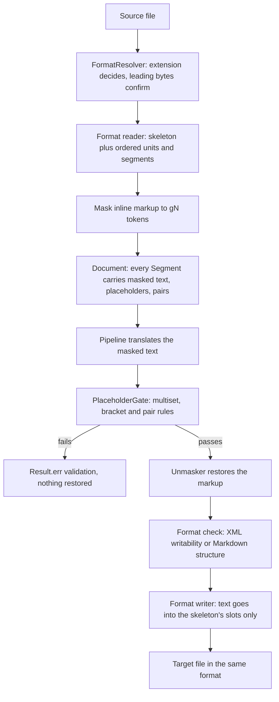

# Document engine

This page describes `:document`, the module that turns a book file into ordered translatable segments, protects inline markup behind placeholders, restores translated text behind a hard gate, and writes the book back with its structure untouched.

## Contract

`:document` implements three `:api` ports and nothing else is visible outside the module:

| Port | Implementation | Job |
|---|---|---|
| `DocumentPort` | `DocumentService` | `open`, `write`, `close`, `unmask`, `repairPlaceholders` |
| `BookInspector` | `BookInspectorService` | `inspect` (what a book is, before any translation), `profile` |
| `SentenceSplitter` | `IcuSentenceSplitter` | split an oversized masked segment at sentence boundaries |

`DocumentService` is the single place where the typed exceptions used inside the module (`CorruptContainerException`, `DrmRefusedException`, `MalformedFragmentException`, `DocumentNotOpenException`, `MaskInvariantException`) become `Result`/`AppError`. Parsed state is held in per-format registries (`OpenEpubRegistry`, `OpenFb2Registry`, `OpenMarkdownRegistry`, `OpenTxtRegistry`) keyed by `Document.id`; `close` releases it.

## The round trip

1. **Parse.** The reader produces a skeleton (a parsed tree, or the original byte buffer for Markdown and TXT) and an ordered list of `Unit`s, each with ordered `Segment`s. A `Segment` holds `sourceInner`, `masked`, an ordered placeholder map, `sourceHash`, neighbour hashes, an anchor (`NodeAnchor`, `ByteSpanAnchor` or `AttributeAnchor`), and the stored decision (`status` PENDING, ACCEPTED, FLAGGED or REVISED, plus `targetInner`). The skeleton is addressed by an opaque `SkeletonHandle`, so parser types never reach the shared classpath.
2. **Mask.** Inline markup the model must not see or alter becomes `⟦gN⟧` tokens (details below). Masking never changes `sourceInner` or `sourceHash`, and identical bytes mask to identical tokens.
3. **Translate.** Done in `:pipeline`, which sees only masked text and the ports.
4. **Unmask.** `DocumentService.unmask` normalises line-break spacing, runs `PlaceholderGate`, restores the markup with `Unmasker`, then applies a format check. `repairPlaceholders` is the code-side repair of a reply whose tokens are wrong, in two modes (`RESTORE_MISSING`, `REWRAP_ALL`).
5. **Write.** The format writer puts each decided text into its own slot in the skeleton and re-emits the container. A segment with no decision is written from its source, so a stopped run still exports.

## Formats

`BookFormat` is `EPUB` (`.epub`), `FB2` (`.fb2`, `.fb2.zip`), `MARKDOWN` (`.md`, `.markdown`) and `TXT` (`.txt`). Export is same-format only.

**Resolving the format.** The file extension decides and the leading bytes only confirm (`FormatResolver`): every text file is valid Markdown and TXT, so trying parsers in turn would accept a corrupt EPUB as a Markdown book. A zip signature is required where a container is expected; a bare FB2 must start with a FictionBook root; Markdown and TXT reject archives and binary content. A `.txt.zip` bundle or a directory named `.fb2` is refused with its own reason before any parser runs.

| | Parsed | Preserved on write | Refused | Yields no segment |
|---|---|---|---|---|
| **EPUB** | Every zip entry is captured in stream order (limits: 10,000 entries, 256 MiB total, compression ratio 200; legacy IBM437 names accepted). `container.xml`, then the OPF (manifest, spine, `dc:language`, title, creator), then each XHTML file via jsoup. A block is a segment when it owns direct text (ADR-0027); ` ` splits it into runs. A spine item whose file is missing is skipped with a warning. | `mimetype` first and STORED (synthesised if the source had none, ADR-0030); every other entry in original order with its own compression method; ids, namespaces, CDATA, comments, entities; each document's prolog verbatim; the target language written where reading systems look (`dc:language`, the OPF language meta, `xml:lang`/`lang`); sort keys of a changed title or creator adjusted or removed. | Encrypted content that is not a manifest-declared font (ADR-0026); zip-level encryption; no OPF metadata; a spine with no present file. | `pre`, `code`, `math`, `svg`, `listing` content; blocks with no direct text. |
| **FB2** | One XML document through `SecureXml` (entities expanded from the book's header or a bundled list; an external DTD subset is answered from that list and never fetched); declared encoding cross-checked by ICU over prose; `title-info`; the same block walker over JDOM2. | Container echoed (bare stays bare, zip stays zip); encoding name and line-ending style; comments, CDATA, entity spelling; a byte-order mark exactly when the source had one. If a target character cannot be encoded in the declared charset the whole file is written as UTF-8 with the declaration rewritten (ADR-0029). | Encrypted zip member; a declared encoding that contradicts the content. | `math`, `svg`, `pre`, `listing`. FB2 `code` is prose style and is entered. |
| **Markdown** | commonmark parse for analysis only; the skeleton is the original byte buffer. Leading `---` frontmatter is split off. One segment per translatable leaf block. A bare web address in prose is one atomic token. | Original bytes copied and only translated spans replaced, in one ascending pass; emphasis markers, bullets, fences, trailing newline untouched. An existing top-level frontmatter `lang` is replaced by the target tag; a `lang` key is never added. Unrepresentable text is written whole as UTF-8 (ADR-0029). | None specific. | Fenced and indented code, raw-HTML blocks, link-reference definitions, frontmatter keys, and values YAML reads as another type (number, boolean, date, URL, list, map). |
| **TXT** | No parser: blank-line boundaries scanned over bytes; one `PARAGRAPH` per block. | Byte-exact: encoding, BOM, line endings. Unrepresentable text is written whole as UTF-8, with a BOM exactly when the source had one. | None specific. | Nothing. |

## What may change

The skeleton is never regenerated. A translated book differs from its source only in:

- text nodes (or byte spans, for Markdown and TXT) covered by decided segments;
- attribute values on the allowlist: image `alt` text (ADR-0041);
- in an EPUB package, the language rewrite and the sort keys of a changed title or creator: a title's `opf:file-as`, `calibre:title_sort` and file-as refine are removed, and a creator's `file-as` is rewritten from the translated name when it has two or more words in an alphabetic script and the source key was surname-first, otherwise removed;
- in Markdown, an existing frontmatter `lang` value.

Everything else must survive: ids, anchors, images, fonts, entry order, namespaces, comments. The guard is the golden round-trip suite: a no-op open and write must be canonical-equal to the source (re-parse-equal or canonical-XML equal; EPUB entry order, `mimetype` handling and decompressed canonical content; TXT exact bytes). Raw byte equality is not asserted for structured formats. Tests live under `modules/document/src/test/java/ua/bookloom/document/golden/` (for example `EpubGoldenRoundTripTest`, `FormatGoldenRoundTripTest`, `AllFormatsDeterminismTest`), with comparators such as `EpubCanonicalAssert` that are themselves mutation-tested by `GoldenComparisonMetaTest`. The owner's corpus sweep (`./gradlew :document:corpus`, local only) repeats the identity round trip over a large private collection.

## Masking

- **Token shape.** `⟦gN⟧`: U+27E6, `g`, digits, U+27E7. Numbering is dense from 0 in order of first appearance. `MaskWriter` refuses to build a mask whose token set and map disagree.
- **Paired and atomic.** An element with translatable children becomes an open token, masked children, and a close token (a pair, recorded as a `PlaceholderPair`, ADR-0040). An empty element, CDATA, a comment or a processing instruction becomes one atomic token holding the exact source markup. Never entered, always atomic: `math`, `svg`, `pre`, `listing`, and `code` in XHTML.
- **Literal brackets.** A literal `⟦` or `⟧` in prose is itself masked, so source text can never forge a token.
- **Character data.** Masked text is character data: markup is composed back from fragments rather than substituted into a markup string (ADR-0031).
- **Per format.** `TreeMasker` masks EPUB and FB2 trees; `MarkdownMasker` masks by the source ranges of inline constructs (`MarkdownSpans`); TXT has nothing to mask (`PlainTextMasker` handles the plain-text slots).
- **Language declarations.** Each pair records the `lang` or `xml:lang` its inline element declares, so the pipeline can keep a foreign-language run verbatim.

## The placeholder gate

`PlaceholderGate.compare` is the hard gate between a model reply and the book. It checks, in terms of `GateRule`:

| Rule | A reply is refused when |
|---|---|
| `STRAY_BRACKET` | a bracket glyph stands outside any whole token (a token split by a space or misspelt) |
| `MULTISET` | a token is missing, duplicated or invented |
| `PAIR_ORDER` | a pair closes before it opens, or two pairs overlap instead of nesting (ADR-0040) |
| `EMPTIED_PAIR` | a pair that held text in the source holds none in the target |
| `LINE_BREAK` | a line-break token moved to a different innermost pair |
| `TEXT_OUTSIDE_PAIRS` | the source has text outside every pair and the target has none (one pair now wraps all the words) |
| `PAIR_SPAN` | a pair that wrapped a phrase now wraps a share of the words several times smaller or larger |

Atomic tokens stay free to move. On any failure nothing is restored and the translation is returned unaltered as `ErrorCode.validation`; `SafeDetails` carries the expected tokens in full and the observed ones bounded.

After the gate:

- **EPUB and FB2:** `Unmasker` restores the markup in one pass, escaping `&`, `<` and `>` between tokens, then the result must be writable as XML (no character XML 1.0 forbids).
- **Markdown:** `MarkdownEscaper` escapes constructs the model introduced (only when the restored text has more of that construct than the source), at most 20 rounds; `MarkdownStructureCheck` then parses source and result and compares multisets of construct types. A mismatch is `validation`.
- **TXT:** the restored text is the result.

Image `alt` values and frontmatter values come back as plain text, because the writer encodes them once.

## Charset detection

`CharsetLadder` picks an encoding for text formats: byte-order mark, then an in-band declaration, then ICU detection (minimum confidence 10; pure ASCII short-circuits to UTF-8), then UTF-8. `ForeignWordCoherence` re-ranks only when the winner is a single-byte charset, so a Western book with a short passage in another script is not misread as a different single-byte encoding.

## Inspection

`BookInspectorService` answers what a book is before any translation. Its verdict is `InspectionVerdict`: `READABLE`, `DRM_PROTECTED` (with the scheme named), `UNSUPPORTED`, `DAMAGED` or `NO_TEXT`. It also reads language evidence from the book's metadata only (ADR-0037), extracts the cover, builds the structure tree from the book's own navigation so every body segment is counted in exactly one node, and computes statistics. It never needs the network. `BookInspector.profile` adds the tree and statistics for an opened `Document`. The per-format logic is in `*Inspection` and `*StructureBuilder` classes.

## Sentence splitting

`IcuSentenceSplitter` divides an oversized masked segment at the source language's sentence boundaries. Placeholder tokens are neutralised to a single object-replacement character before ICU sees them, and pieces concatenate back to the original without cutting a pair. `:pipeline` holds no ICU; it receives the port.

## Auxiliary text units

Every opened book ends with one auxiliary unit (id `aux`, ADR-0041), always produced; the Book Brief's "Also translate" switches decide only whether a run translates it. It holds:

- EPUB: navigation-document link texts, NCX labels that differ from them, and image `alt` values;
- FB2: `book-title`, authors (one pair around each name part) and annotation paragraphs;
- Markdown: frontmatter text values and image alternative text.

These segments use `SegmentKind` values `METADATA_TITLE`, `METADATA_AUTHOR`, `METADATA_DESCRIPTION`, `FRONTMATTER_VALUE` and `ALT`, are addressed by an `AttributeAnchor` or the node of the metadata they come from, and are written back into their own slots. A zero-edit round trip is still canonical-equal.

## Error mapping

| Cause | `ErrorCode` |
|---|---|
| DRM refusal, corrupt container, malformed fragment, gate mismatch, structure mismatch, unwritable XML character, unrepairable placeholders | `validation` |
| Document id not open (registry miss), any other unexpected exception | `internal` |

`details` never contains paths, bodies or exception messages (`SafeDetails`).

## Known limits

Raw-HTML blocks, code blocks and link-reference definitions in Markdown are never translated; the Markdown structure check is per segment, so a construct spanning segments is not caught. See [known limits](../known-limits.md) for the maintained list.

## See also

- [Overview](overview.md), [UI](ui.md), [Decisions index](decisions.md)
- [Testing](../development/testing.md) for the golden and corpus tests
- [Document model spec](../spec_baseline/specification/02_Architecture/03_DOCUMENT_MODEL.md), [document formats spec](../spec_baseline/specification/01_Product/03_DOCUMENT_FORMATS.md)
- ADRs: [0003](../spec_baseline/adr/ADR-0003-document-skeleton-segment-model.md), [0025](../spec_baseline/adr/ADR-0025-reassembly-replaces-run-inner-content.md), [0026](../spec_baseline/adr/ADR-0026-drm-adjudication-by-encrypted-resource.md), [0027](../spec_baseline/adr/ADR-0027-structural-block-segmentation.md), [0031](../spec_baseline/adr/ADR-0031-masked-text-is-character-data.md), [0040](../spec_baseline/adr/ADR-0040-placeholder-pairs-keep-their-order.md), [0041](../spec_baseline/adr/ADR-0041-translatable-attribute-values.md)
