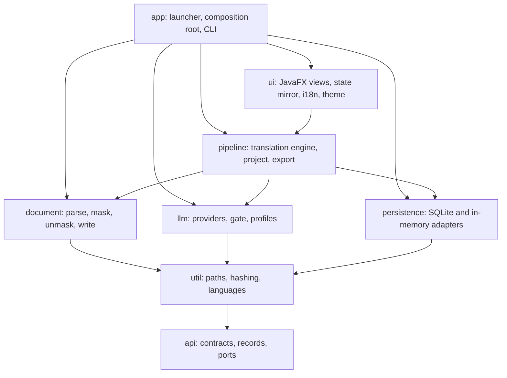
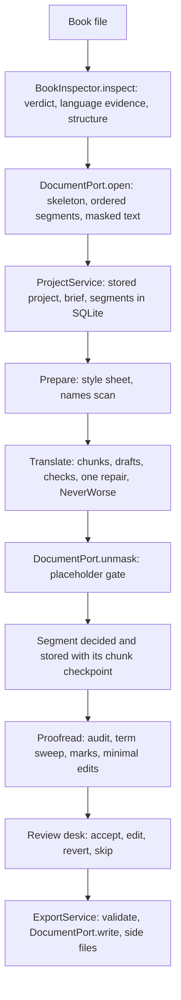

# BookLoom architecture overview

This page explains how BookLoom is put together: the eight Gradle modules and their layering, the ports between them, how the app starts, how a book travels from import to export, and which invariants (offline, privacy, errors, threading, persistence, logging) the code enforces and how.

## What BookLoom is

BookLoom is a local-first desktop application that translates whole books (EPUB, FB2, Markdown, TXT) with a locally run language model (Ollama, LM Studio, llama-server and similar) or any OpenAI-compatible endpoint. It keeps the book's structure, IDs, images and fonts: the translated book is the original skeleton with only its text replaced, and a book with zero edits round-trips canonical-equal to its source.

The same pipeline runs from the JavaFX window and from a headless command line (`./gradlew -q :app:translate`, see [running](../development/running.md)). A run works on a stored project in SQLite, so projects, settings, briefs, glossaries and every decided segment survive a restart. Export is a separate action that makes no model call.

## Goals and constraints

| Constraint | What it means in code |
|---|---|
| Local-first, offline | Opening, parsing, masking, translating against a local model and exporting need no network. Only `:llm` holds HTTP code. |
| Private when used with local models | A book stays on this computer when the provider is a local model. With a provider outside this computer, the text being translated is sent to that provider's host, which is the person's own choice. There is no consent step for a remote provider. |
| Structure-preserving round trip | The skeleton is never regenerated; only text nodes and a short list of attribute values change. Guarded by per-format golden tests. See [document engine](document-engine.md). |
| Single-flight local inference | One model call at a time, through one `InferenceGate` (a one-permit semaphore). |
| Failures are data | `Result<T>` with a typed `AppError` at every port; no exception crosses a module edge. |
| Secrets are references | A credential is an environment-variable name, never a stored value. |

## Module layering

Edges point downward only. `settings.gradle.kts` maps each project onto `modules/<name>` (ADR-0021).

`:app` and `:ui` also see `:api` and `:util` directly; the allowed-edge table is `ModuleGraph.ALLOWED_EDGES` in `modules/app/src/archTest/java/ua/bookloom/archtest/ModuleGraph.java`. Only `:ui` and `:app` may see JavaFX.

| Module | Responsibility | Key packages (`ua.bookloom.…`) | Notable classes |
|---|---|---|---|
| `:api` | Contracts only, framework-free: the failure envelope, the document model, project and brief records, and every port. | `api`, `api.document`, `api.llm`, `api.pipeline`, `api.persistence`, `api.project`, `api.settings` | `Result`, `AppError`, `ErrorCode`, `SafeDetails`, `DocumentPort`, `ChatModel`, `TranslationEngine`, `TranslationJob`, `ProjectRepository` |
| `:util` | Foundation: per-OS paths, hashing, the language catalogue, text helpers, the evidence-log marker. | `util.paths`, `util.hash`, `util.lang`, `util.files`, `util.text`, `util.log` | `AppPaths`, `AppPathsResolver`, `AppEnvironment`, `Languages`, `HashUtil`, `EvidenceLog` |
| `:document` | Parse, mask, unmask and reassemble the four formats; inspect a book; split sentences; detect charsets. | `document.epub`, `.fb2`, `.md`, `.txt`, `.mask`, `.model`, `.inspect`, `.split`, `.detect` | `DocumentService`, `BookInspectorService`, `PlaceholderGate`, `Unmasker`, `CharsetLadder`, `IcuSentenceSplitter` |
| `:llm` | Chat-model contract implementations, gated and retried clients, engine detection, per-model profiles, verification, discovery. | `llm`, `llm.client.ollama`, `llm.client.openai`, `llm.gate`, `llm.engine`, `llm.profile`, `llm.verify`, `llm.pseudo`, `llm.response`, `llm.retry` | `ChatModelFactoryImpl`, `GatedChatModel`, `InferenceGate`, `OllamaClient`, `OpenAiCompatibleClient`, `EngineDetector`, `ModelProfiles`, `ProviderVerifierImpl`, `PseudoChatModel` |
| `:persistence` | Storage adapters behind the `:api` storage ports: SQLite (window) and in-memory (CLI, tests). | `persistence.sqlite`, `persistence.memory` | `SqlitePersistenceModule`, `InMemoryPersistenceModule`, `SqliteDatabase`, `WriteExecutor`, `StoredShapes`, `SqliteCheckpoint` |
| `:pipeline` | The translation engine: prompts, context builder, chunk packing, deterministic checks, the repair gate, Proofread, glossary, memory, project service, export. | `pipeline`, `.context`, `.chunk`, `.checks`, `.qa`, `.proofread`, `.memory`, `.glossary`, `.project`, `.export`, `.review`, `.setup` | `TranslationEngineImpl`, `TranslationJobImpl`, `ContextBuilder`, `ChunkPacker`, `NeverWorse`, `ProofreadStage`, `TranslationMemory`, `StallWatchdog`, `ExportServiceImpl`, `PipelineModule` |
| `:ui` | JavaFX views, the observable state mirror, i18n, theming, dialogs. See [ui](ui.md). | `ui`, `ui.screen`, `ui.control`, `ui.dialog`, `ui.state`, `ui.i18n`, `ui.theme`, `ui.notify` | `AppShellView`, `Navigator`, `ViewNames`, `StateMirror`, `TranslationRunner`, `ThemeController`, `Messages`, `MessageKey`, `UiModule` |
| `:app` | Boot, logging, single-instance lock, DI, the window, the command line, the `archTest` suite. | `app`, `app.bootstrap`, `app.cli`, `app.env` | `Launcher`, `BookLoomApplication`, `AppLifecycle`, `CoreModules`, `AppModule`, `LoggingBootstrap`, `SingleInstanceLock`, `TranslateLauncher`, `TranslateCommand` |

`modules/build-logic` is an included build holding the shared Gradle conventions, not a runtime module. A package-by-package inventory is `docs/spec_baseline/implementation_plan/01_MODULE_INVENTORY.md`.

## Ports and who implements them

Consumers hold `:api` ports, never another module's concrete classes (ArchUnit `PORTS_NOT_CONCRETES`).

| Port (`ua.bookloom.api…`) | Implemented by | Module |
|---|---|---|
| `document.DocumentPort` | `DocumentService` | `:document` |
| `document.BookInspector` | `BookInspectorService` | `:document` |
| `document.SentenceSplitter` | `IcuSentenceSplitter` | `:document` |
| `llm.ChatModelFactory` | `ChatModelFactoryImpl` (builds `PseudoChatModel` or a gated, retried client) | `:llm` |
| `llm.ProviderVerifier`, `llm.ModelCatalog` | `ProviderVerifierImpl`, `ModelCatalogService` | `:llm` |
| `llm.ProviderConfigs`, and the repositories `SettingsRepository`, `ModelSettingsRepository`, `ProjectRepository`, `SegmentRepository`, `GlossaryRepository`, `LexiconRepository`, `TmRepository`, `SummaryRepository`, `DeferralRepository`, `RunRepository`, `PromptFrameRepository`, `StorageInfo` | `Sqlite…` and `InMemory…` adapters, one pair per port | `:persistence` |
| `persistence.CheckpointPort` | `SqliteCheckpoint`, `InMemoryCheckpoint` | `:persistence` |
| `pipeline.TranslationEngine` (returns a `TranslationJob`) | `TranslationEngineImpl` | `:pipeline` |
| `pipeline.ProjectService`, `ExportService`, `GlossaryService`, `LexiconService`, `NamesPass`, `ReviewDesk`, `SetupAssistant` | `ProjectServiceImpl`, `ExportServiceImpl`, `GlossaryServiceImpl`, `LexiconServiceImpl`, `NamesPassImpl`, `ReviewDeskImpl`, `SetupAssistantImpl` | `:pipeline` |

The engine never names a provider: it is handed a `ChatModel` already bound to one (ADR-0033). Model profiles (reasoning field, system role, samplers, structured-output rung, window) are resolved inside `:llm` per call (ADR-0047).

## Startup and the composition root

`Launcher.main` runs before JavaFX starts, so it holds no static logger and touches the network and UI toolkit not at all:

1. Resolve the environment (`BOOKLOOM_ENV`, then `-Dbookloom.env`, else dev) and the data and log directories per OS (`AppPathsResolver`, `AppPaths`). Dev uses a `-Dev` suffix; `BOOKLOOM_DATA_DIR` overrides.
2. Take the single-instance lock: `FileChannel.tryLock` on `bookloom.lock` in the data directory (`SingleInstanceLock`). A second launch is `ErrorCode.busy`, shows "BookLoom is already running" and exits 0.
3. Resolve the log level (`LoggingLevelResolver`) and the review mode (`ReviewModeResolver`), then configure Logback programmatically (`LoggingBootstrap`). The log directory is published before the first logger is created.
4. `Application.launch`. A startup failure shows `StartupFailureDialog` and exits 1.

`BookLoomApplication.init` builds the Guice injector from `CoreModules` plus `UiModule` and `DesktopModule`, then runs `AppLifecycle`:

- Phase 1 constructs services and does no I/O.
- Phase 2 opens resources: the SQLite database (schema applied on open) and the bundled model-knowledge files. A database that cannot be opened is a startup error.
- The first scene is built only after phase 2; `AppLifecycle` refuses to run the steps out of order.

`CoreModules(startup, persistenceModule)` installs `AppModule` (paths, environment, startup context, the two executors), `DocumentModule`, `LlmModule`, the persistence module it is given, and `PipelineModule`. The window passes `SqlitePersistenceModule`; the command line (`TranslateLauncher`, which repeats the pre-injector steps without JavaFX) and most tests pass `InMemoryPersistenceModule`. Both entry points therefore build the same service graph and differ only in storage. With `-Dbookloom.smoke.resolveAll=true`, `ResolveAll` loads every screen and resolves every explicit `ua.bookloom.api` binding in Guice's production stage.

Constructor injection only; no field or setter injection, no service locator. A Guice-built service uses `@RequiredArgsConstructor(onConstructor_ = {@Inject})`.

## Data flow: import to export

In words:

1. **Inspect and open.** `:document` reports what the book is (readable, DRM-protected, unsupported), then parses it into a `Document`: ordered `Unit`s and `Segment`s, each with a masked form where inline markup is replaced by `⟦gN⟧` tokens. Detail: [document engine](document-engine.md).
2. **Store.** `ProjectService` matches the book's content against stored projects (a known book is never imported twice) and keeps the project, the Book Brief, the segments and their status in the storage ports.
3. **Run.** `TranslationEngine.newJob` returns a pausable `TranslationJob`. It runs the stages Prepare, Translate and Proofread over the stored project from its first pending segment. Translate packs units into token-budgeted chunks, drafts them in JSON batches, resolves protected spans by code, runs deterministic checks and decides each segment by the acceptance rule: a failing draft gets one repair call, and the new text stays only through `NeverWorse` (ADR-0046). A chunk's decisions and the run record commit in one transaction (`CheckpointPort.commit`). The full algorithm is in the pipeline documentation, with the canonical diagrams `docs/spec_baseline/specification/diagrams/pipeline.mermaid` and `chunk-translate-loop.mermaid` ([pipeline](../spec_baseline/specification/diagrams/pipeline.mermaid), [chunk loop](../spec_baseline/specification/diagrams/chunk-translate-loop.mermaid)).
4. **Review.** The review mode (Unattended, Assisted, Manual) decides only when the run pauses; the quality dial (Fast, Balanced, Max) decides the fixing call and how far Proofread reads. The review desk works on stored decisions.
5. **Export.** A separate action (ADR-0035). `ExportServiceImpl` validates each segment, writes the book in its own format, the chosen side files (glossary CSV, bilingual HTML, quality report) and reports the stored Proofread summary. It asks before replacing a file and makes no model call, which ArchUnit enforces (`EXPORT_MAKES_NO_MODEL_CALL`). A stopped or partial run can be exported; untranslated text stays in the source language.

## Error envelope

Every `:api` port method returns `Result<T>(data, error)`: exactly one of the two is non-null, with `isOk`, `isErr`, `map` and `flatMap`. A failure is always an `AppError(code, title, message, details, retryable, cause)`; there is no per-module error type.

- `ErrorCode` has 15 constants: `auth`, `timeout`, `rateLimited`, `unreachable`, `modelNotFound`, `discoveryFailed`, `modelUnavailable`, `upstream`, `missingCredential`, `contextWindow`, `emptyCompletion`, `cancelled`, `validation`, `internal`, `busy`. `timeout`, `rateLimited`, `unreachable`, `discoveryFailed` and `upstream` are retryable; `retryable` must agree with the code.
- A known failure is classified to its code where it is recognised: HTTP in `:llm`, SQL in `:persistence`, parse and gate failures in `:document` (both map to `validation`).
- `details` can only be built through `SafeDetails`, an allowlist type (HTTP status, endpoint host only, model name, timeout, attempt count, QA finding names, bounded placeholder lists). There is no way to put an exception message, a body or a secret into it; `cause` is for logs and never shown.
- Every public port method has a boundary `try/catch` that wraps an escaping `Exception` as `Result.err(internal)`. An `Error` is never swallowed.
- A failure is logged once, where the `AppError` is first built.
- Long operations return partial results rather than failing all-or-nothing: a run carries accepted and flagged counts plus an optional terminal error, so export stays available after a mid-book provider failure.

## Threading

| Rule | Mechanism |
|---|---|
| The FX Application Thread is for the scene graph only | No blocking, I/O or translation work on it. See [ui](ui.md#the-state-mirror-and-the-fx-thread-rule). |
| Background work runs on injected executors | `@BackgroundExecutor` is a fixed daemon pool for bounded, cancellable work; `@IoExecutor` is `Executors.newVirtualThreadPerTaskExecutor()` for blocking I/O fan-out. Both are provided in `AppModule`. Virtual threads are not used for gated inference. |
| One model call at a time | `InferenceGate` (`ua.bookloom.llm.gate`) is a `Semaphore(1)` that blocks; every client call goes through it via `GatedChatModel`. |
| Pause and Stop are prompt | `JobControl` interrupts the job thread inside `CancellableChatModel`; the client returns `cancelled` and the gate is released. |
| A hung call ends | Each call has an output cap, a per-kind timeout and one retry with a new seed and lower cap; `StallWatchdog` ends a call held 1.5 times its timeout, or a run with no progress for 20 minutes. |
| No `synchronized` in new code | Immutability, thread confinement, `java.util.concurrent`, the gate. |
| Resume | A chunk's decisions commit atomically, so a pause or crash resumes at the first pending segment without redoing accepted work. |

## Persistence

`:persistence` has two adapter families behind the same `:api` storage ports, each with its own Guice module:

- `SqlitePersistenceModule(file, clock)` binds the SQLite adapters over one singleton `SqliteDatabase`. The window installs it, and the database is `bookloom.db` in the per-OS data directory.
- `InMemoryPersistenceModule` binds in-memory adapters over one `InMemoryStore`, for the command line and tests (ADR-0034). It never creates `bookloom.db`.

`RepositoryContractTest` (`modules/persistence/src/test/java/ua/bookloom/persistence/contract/`) runs the same contract against both families.

SQLite details (ADR-0043):

- WAL mode through `sqlite-jdbc` and JDBI 3; explicit SQL, no ORM. `journal_mode=WAL`, `foreign_keys=ON`, `synchronous=NORMAL` and a busy timeout are applied on every connection.
- Reads use their own connections; all writes go through one `WriteExecutor`.
- State is kept as JSON documents in a few tables (`meta`, `settings`, `providers`, `model_settings`, `books`, `projects`, `project_docs`, `segments`, `tm_entries`, `deferrals`), with real columns only where an index, a uniqueness rule or a cascade needs them. Preferences live in a typed key-value `settings` table.
- A chunk's decisions, memory entries, deferrals and new names are one transaction (`CheckpointPort.commit`). WAL with `synchronous=NORMAL` is process-crash-safe; on power loss the last in-flight commit may be lost, never earlier accepted work.
- **One schema file, no migrations before the first release.** `modules/persistence/src/main/resources/db/schema.sql` is a list of `CREATE TABLE IF NOT EXISTS` statements whose number is held in `PRAGMA user_version`. A database with another `user_version`, another stored-record fingerprint (`meta.record_shapes`, kept by `StoredShapes`) or one that cannot be opened is renamed `bookloom.db.old-<yyyyMMdd-HHmmss>` and a fresh one is created, with one WARN line and no data carried over. From the first release, schema changes become additive Flyway migrations.
- Secrets are never stored: a provider keeps an environment-variable name.

## Offline and privacy

- No background, scheduled or unsolicited network call. The expected outbound calls are user-triggered provider communication (inference, model discovery, verification, server-engine detection on Save, Test or Detect again) to the configured provider.
- **The one exception (ADR-0044):** on the very first launch only (a fresh database counts), after the window is shown, one silent model listing of exactly `http://127.0.0.1:11434` (Ollama `/api/tags`) and `http://127.0.0.1:1234/v1` (LM Studio `/models`). No other address, no prompt or book text; nothing answering is not an error; it is never repeated by itself and applies to the desktop window only. The code is `LocalModelProbe` in `:ui`, which calls the `:llm` port, and a stored `firstLaunch.probed` setting records that it ran.
- Opening a book never fetches anything: an XML DOCTYPE is answered from a bundled entity list. Fonts, icons, stylesheets and bundles are packaged, never fetched.
- Model recommendations come from the computer's memory read locally; the pull command is shown as text and never run by BookLoom.
- No telemetry, crash reporting or analytics.
- Privacy wording is always "private when used with local models".

## Logging

Logging is SLF4J with Logback configured programmatically in `LoggingBootstrap` (the only class that may touch Logback types). `BOOKLOOM_LOG_LEVEL` (or `-Dbookloom.log.level`) raises the level of the `ua.bookloom` loggers: default `INFO` installed, `TRACE` in a development run; other loggers stay at `WARN`. INFO marks lifecycle, DEBUG marks method entry with parameters and branches taken, TRACE holds values and book text. Book text, prompts and replies are never logged above TRACE; secrets never.

| File (per-OS log directory) | What it holds |
|---|---|
| `bookloom.log` | The ordinary rolling log at the resolved level. |
| `bookloom-trace.log` | The detailed log: every `ua.bookloom` line down to TRACE, rotated into gzip archives. On in a development run; off in an installed app unless `BOOKLOOM_TRACE_FILE=1` or the Settings switch. |
| `bookloom-trace-evidence.log` | With the detailed log on, the full TRACE of every flagged or repaired segment, outside the rolling cap. |
| `bookloom-trace-run-<launch time>.log` | One small file per launch, always on: BookLoom lines at INFO and above (never book text), the last 10 kept. |

How to share logs and run the app: [running](../development/running.md).

## ArchUnit rules

The rules live in `modules/app/src/archTest/java/ua/bookloom/archtest/ArchitectureRules.java` and run in `BoundaryRulesTest`; `RuleViolationFixtureTest` proves each fires on a deliberate violation and `RuleSuiteCompletenessTest` guards the set.

| Rule | Guarantees |
|---|---|
| `FX_FREE_CORE` | No `javafx.*` in the six core modules. |
| `DEPENDENCY_DIRECTION` | Module edges equal the allowed-edge table above. |
| `PORTS_NOT_CONCRETES` | `:ui` and `:pipeline` hold ports, never another module's implementation classes. |
| `NO_HTTP_IN_CORE_EXCEPT_LLM` | `java.net.http` only in `:llm`. |
| `NO_SQL_IN_CORE_EXCEPT_PERSISTENCE` | SQL, JDBI and Flyway reach no other module. |
| `API_IS_FRAMEWORK_FREE` | `:api` depends on no Guice, Lombok or JavaFX. |
| `RECORDS_FIRST` | Data carriers (`dto`, `api` packages) are records. |
| `BOOTSTRAP_NO_STATIC_LOGGER` | `ua.bookloom.app.bootstrap` and `ua.bookloom.util.paths` hold no static logger. |
| `NO_INLINE_STYLE_IN_UI` | No `:ui` class calls `setStyle` on a JavaFX type. |
| `EXPORT_MAKES_NO_MODEL_CALL` | `ua.bookloom.pipeline.export` cannot reach `ChatModel`, `ChatModelFactory` or `InferenceGate`. |

Two further guard tests in the same source set (`NoReasoningVariableTest`, `NoSamplingVariableTest`) keep retired environment variables out of production code. Rules not enforced by ArchUnit (single-flight inference, credentials as references, scene graph on the FX thread, logging at every level) are advisory and checked in review; see `AGENTS.md`.

## See also

- [Document engine](document-engine.md), [UI](ui.md), [Decisions index](decisions.md)
- [Getting started](../development/getting-started.md), [Running](../development/running.md), [Testing](../development/testing.md), [Quality and CI](../development/quality-and-ci.md)
- [Known limits](../known-limits.md)
- [Module inventory](../spec_baseline/implementation_plan/01_MODULE_INVENTORY.md)
- [System architecture spec](../spec_baseline/specification/02_Architecture/01_SYSTEM_ARCHITECTURE.md), [modules and layering spec](../spec_baseline/specification/02_Architecture/02_MODULES_AND_LAYERING.md)
- [Privacy and offline spec](../spec_baseline/specification/03_NonFunctional/03_PRIVACY_AND_OFFLINE.md)
