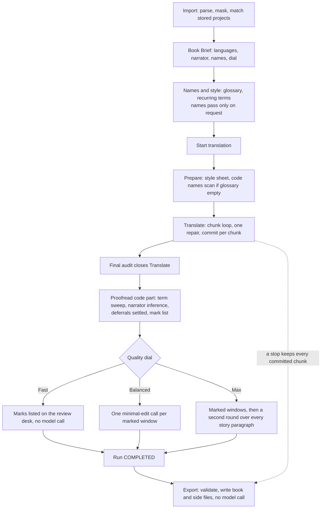
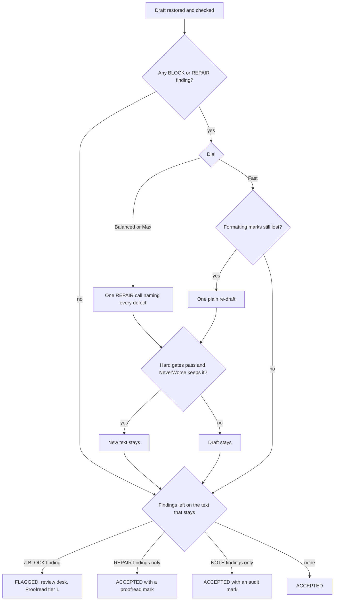
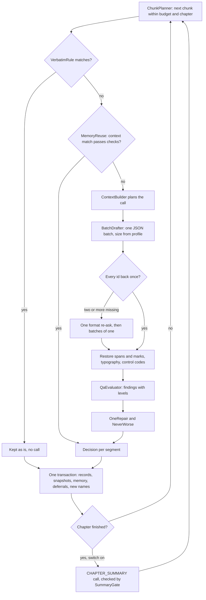

# Translation pipeline

How a book goes from import to an exported translation in the current code: the brief, the three run stages
(Prepare, Translate, Proofread), the bounds on every model call, and export.

The decision behind this shape is [ADR-0046](../spec_baseline/adr/ADR-0046-three-stages-one-repair-never-worse.md)
(three stages, one repair, the never-worse gate); the full requirements are the change
[`redesign-translation-pipeline`](../../openspec/changes/redesign-translation-pipeline/) (`design.md` D2, D8–D16) and
the `translation-pipeline` capability. The canonical diagrams are
[`pipeline.mermaid`](../spec_baseline/specification/diagrams/pipeline.mermaid) (whole book) and
[`chunk-translate-loop.mermaid`](../spec_baseline/specification/diagrams/chunk-translate-loop.mermaid) (one chunk);
the diagrams below are code-level companions and do not replace them.

All classes named here are under `modules/pipeline/src/main/java/ua/bookloom/pipeline/` unless another module is given.

## The flow at a glance

| Step | What happens | Model calls | Where |
|---|---|---|---|
| Import | The book is parsed by `:document` into a skeleton and ordered segments, inline markup masked to `⟦gN⟧` tokens; the content is matched against stored projects so a known book is not imported twice | none | `project/ProjectServiceImpl`, `project/ProjectOpener` |
| Book Brief | Languages, narrator, name policy, quality dial, "Also translate" switches, story shape. ✦ Suggest is person-triggered | only on Suggest (`BRIEF_SUGGESTION`, `BOOK_KNOWLEDGE`, `BRIEF_SYNTHESIS`, `FILE_NAME`) | `setup/SetupAssistantImpl`, `setup/BriefSuggester` |
| Names & style | Glossary and recurring terms; the autonomous names pass is person-triggered and never part of a run | only when the person asks (`PRESCAN`, `TERM_READING`, `NAME_KNOWLEDGE`, `SUGGEST_TARGETS`, `TERM_CHOICE`, …) | `glossary/NamesPassImpl`, `glossary/GlossaryServiceImpl`, `lexicon/LexiconServiceImpl` |
| Run: Prepare | Style sheet from the brief; a deterministic names scan when the glossary is empty | none | `run/PrepStage` |
| Run: Translate | Chunk loop: draft, code repairs, checks, at most one repair, decision, commit | `DRAFT`, `REPAIR`, `CHAPTER_SUMMARY` | `run/ChunkRunner`, `heal/*`, `run/ChapterSummaries` |
| Run: Proofread | Final audit, term sweep, narrator inference, deferrals, mark list; then windows at Balanced/Max | `PROOFREAD` (Balanced and Max only) | `proofread/ProofreadStage` |
| Export | Validate each segment, write the book and side files | none | `export/ExportJobImpl` |

Call kinds are the `CallKind` enum in `modules/api/src/main/java/ua/bookloom/api/pipeline/CallKind.java`.

A run is COMPLETED only after Proofread (`run/StageRunner`). A run stopped during Translate still counts the narrator's
forms over what it decided but runs no audit and no Proofread; Continue resumes whichever stage has work. A stopped or
partial run can still be exported; untranslated segments stay in the source language.

## Prepare

`run/PrepStage` runs before the first model call and is code only:

- **Style sheet.** `prompt/StyleSheet.of(brief)` derives the style guidance from the brief, with its SHA-256 so a run can
  tell whether it changed. Every draft and repair carries it.
- **Names scan.** When the glossary is empty, the deterministic `glossary/FrequencyScan` proposes names (capitalised
  words and runs that recur away from sentence starts), grouped by word forms; when the lexicon is empty its recurring
  terms are proposed too. The model scan never runs inside a run.
- **Narrator hint.** `narrator/NarratorDetector` reads first-person pronoun shares per chapter from the source; the
  hint never changes the brief.

Chapter summaries missing or stale for finished chapters are written before the first draft (`run/ChapterSummaries`).

## Translate

The job (`TranslationJobImpl`, single job thread) walks the pending segments in reading order, starting at the first
pending segment of the stored project.

### Chunks and batches

- `run/ChunkPlanner` packs each unit's pending segments with `chunk/ChunkPacker`: a chunk closes when the next segment
  would exceed the **current-part budget** of the model's tier (`context/WindowBudgets`), and also **at a chapter
  boundary**, so no batch spans two chapters. A segment larger than the budget alone is split (`chunk/OversizedSplit`).
  Token counts are character-based estimates (`chunk/TokenEstimator`).
- Drafts go out as **one flat JSON batch format**, `{"items":[{"id","target"}]}` (`batch/BatchDrafter`,
  `batch/BatchPromptBuilder`, `batch/BatchReplyParser`). The starting batch size is the model profile's `batchSize`
  (`ModelProfile.DEFAULT_BATCH_SIZE` is 2 for an unknown model; the built-in Gemma rows use 2 or 4).
  `chunk/BatchSizeController` halves on a wrong, missing or merged id and grows back one item after a clean streak,
  never above the start size.
- Two or more missing ids get one format re-ask; an id never returned gets a batch of one. These do not count as the
  repair.

### Before the model sees a segment

- **Verbatim, no call** (`heal/VerbatimRule`): a segment whose visible text is nothing (`NO_TEXT`), only a locked name
  (`LOCKED_TERM`), only digits and symbols (`SYMBOLS`), an upper-case Roman numeral, a single character, or a
  one-letter-symbol formula is kept as it is. Invisible text never becomes a segment in the first place (`:document`).
- **Translation memory** (`run/MemoryReuse`, `memory/TranslationMemory`): an entry keyed by the segment's source hash
  and its two neighbours' hashes is reused without a draft, but only after it passes the same gate and checks as a
  draft. Near matches (85 % similarity) become hints. See [context-glossary-memory.md](context-glossary-memory.md).
- **Protected spans** (`memory/ProtectedSpans`): locked glossary names and kept foreign runs are hidden behind extra
  tokens so the model cannot misspell or translate them; they are put back through a hard gate.
- **Context**: one `context/ContextBuilder` plans every call from the book map. See
  [context-glossary-memory.md](context-glossary-memory.md).

### After the reply: code repairs, then checks

1. Protected spans and placeholders are restored; `ControlCharacterMapper` maps control codes a model wrote for quote
   marks or dashes back to real marks when their place is unambiguous; lost formatting marks are put back by code.
2. `typography/TypographyNormalizer` fixes apostrophes, ellipses, the target language's quotes and spacing; stress marks
   are stripped (`typography/StressStrip`). These are code repairs, not model calls.
3. `qa/QaEvaluator` runs the hard gates, the soft checks and the deterministic text checks. Each finding has a level:
   **BLOCK**, **REPAIR** or **NOTE** (`qa/CheckLevel`, read through `qa/CheckLevels`). The catalogue is in
   [quality-gates.md](quality-gates.md).

### Acceptance, the one repair and the never-worse gate

`heal/AcceptanceRule` accepts a text when every hard gate passes, no soft check failed outright and no BLOCK finding is
left. There is no score threshold. `heal/OneRepair` decides the fixing call:

- **Balanced and Max** (`RepairMode.ONE`): any BLOCK or REPAIR finding earns exactly **one** `REPAIR` call that names
  every defect with its quoted span.
- **Fast** (`RepairMode.MARKS_ONLY`): no repair; only a text whose formatting marks the code could not restore is
  drafted once more, plainly.
- A repaired text replaces the draft only if it passes the hard gates **and** `qa/NeverWorse.judge` keeps it.

A provider error answered on a repair call is routed like any other call error (below); a reply the model kept
repeating (`repeat-limit`) or a passage that does not fit the window flags the segment at once instead of pausing.

### Per-chunk loop in code

### What a chunk commit stores

A chunk's decisions are committed in **one transaction** (`run/PendingCommit`, `run/RunRecorder`, the `CheckpointPort`
in `:api`): the segment records with their status (`SegmentStatus`: `PENDING`, `ACCEPTED`, `FLAGGED`; `REVISED` comes later from a person's edit or a kept Proofread
rewrite),
each draft's context snapshot (`ContextSnapshot`), the translation-memory entries of accepted segments, new deferrals,
new names, and the run record. A record already committed is never committed again, so an edit the person saved while
the run was paused is not overwritten. After a restart the undecided chunk is drafted again.

Also recorded during the run:

- **Deferrals** (`proofread/DeferralRegister`, `DeferralReason`): `TERM` when a pinned or locked rendering changes after
  segments used the old one; `GENDER_UNKNOWN` for a character with no gender yet; `GENDER_CHANGED` when an enforced
  gender arrives later; `PROOFREAD` for a kept rewrite that must wait as a proposal. Every glossary writer goes through
  `DeferralRegister.changed`, so no path records one kind and misses the other.
- **Recurring terms** are learned from decided pairs with no model call (`lexicon/CooccurrenceLearner`, `run/TermLearning`).
- **Chapter summaries**: each finished chapter (except the last) gets one stored summary while the brief's switch is on.

## Proofread

`proofread/ProofreadStage` runs at **every** dial once the last chunk is decided:

1. **Final audit** (`run/RunAudit`, `audit/FinalAudit`): the cheap checks again over every accepted segment no person
   reviewed; its doubts become audit marks. It is not rerun after Proofread.
2. **Term sweep** (`proofread/TermSweep`): each open `TERM` deferral's old rendering is replaced by code: whole-word for
   locked entries, form by form for pinned ones, never for suggested ones. A person-edited segment gets a proposal.
3. **Narrator inference** (`narrator/NarratorInference`): an unstated first-person narrator's gender is inferred from the
   decided past-tense forms once enough agree.
4. **Deferrals settled by code**: no mismatch means resolved with no call.
5. **Mark list** (`proofread/MarkList`, `proofread/MarkDetectors`): tier 1 = FLAGGED segments, REPAIR findings left
   after the repair, deferrals whose fact arrived; tier 2 = NOTE findings, audit doubts and the detectors' doubts. A
   machine text the person already reviewed is never listed. Nothing is stored; the list is read from the records.

Then by dial (`dial/DialParameters`):

| Dial | Translate | Proofread |
|---|---|---|
| Fast | draft + free checks; no fixing call except one re-draft for lost marks | code only; the marks go to the review desk |
| Balanced | + the one repair | + one minimal-edit `PROOFREAD` call per marked window (tiers 1 and 2) |
| Max | as Balanced | + a second round over every story paragraph |

Windows (`proofread/ProofreadWindows`) merge nearby marks up to the profile's batch size, with one read-only neighbour
each side. The reply is `{"unchanged":true}` or changed items; every change goes through `NeverWorse`. A kept rewrite on
an ACCEPTED segment makes it `REVISED` and stores the text before; a rewrite of a person's edit or of a FLAGGED segment
it does not unblock becomes a proposal. Each window stores a `ProofreadVerdict` with a fingerprint, so a resumed run
skips windows already read with the same inputs.

## Review modes and the review desk

The **quality dial** (Fast / Balanced / Max) decides only the fixing call and how far Proofread reads. The **review
mode** (`ReviewMode`: Unattended, Assisted, Manual; a setting and a launch flag) decides only when a run pauses. They
are independent.

| Review mode | Pauses |
|---|---|
| Unattended | never for review |
| Assisted | on a flagged segment and on an error |
| Manual | after every segment, on a flagged segment and on an error |

The review desk (`review/ReviewDeskImpl`, `review/SegmentActions`, `review/RetryDraft`) offers accept, edit, revert,
skip, apply a proposal, Changed by proofread, Undo proofread and Try again; Try again rebuilds the context from the
current glossary and settings. Every action is checked against the segment status machine and writes one record.

## Bounded calls, pauses and recovery

| Bound | Value / rule | Where |
|---|---|---|
| Output cap | every translate-family call states an expected length and a hard cap sized from the source and the pair's `outputRatio` | `prompt/OutputLimit`, `context/OutputReserve` |
| Timeout per kind | helper calls 2 min (longer for a model that always thinks); others `max(provider timeout, min(600 s, 0.5 s × expected tokens))` | `:llm` `http/RequestTimeouts`, `CallLimits` |
| Streaming idle gap | an Ollama stream silent for 60 s (or the shorter provider timeout) counts as stalled | `CallLimits.STREAM_IDLE` |
| Retry | at most 3 requests per logical call, at most 2 timeouts; a timed-out retry gets a new seed and a lower cap | `:llm` `retry/RetryPolicy` |
| Stall watchdog | ends a call held 1.5× its timeout (15 min if it has none), or after 20 min with no decided segment and no answered Proofread call | `StallWatchdog` |
| Single flight | every model call holds one fair permit | `:llm` `gate/InferenceGate` |

When a call returns an error, `run/PauseDecider` routes it by `ErrorCode`: flag the segment and go on, end Cancelled
(the person stopped), pause (or fail when pausing on errors is off), or fail with `internal`. A step that pauses twice is
flagged and the run goes on. A paused run can **skip** the failing segment; **resume** continues at the call that
failed. For outages (unreachable, 5xx, 429, timeout) `UnattendedRecovery` probes the provider on `RecoverySchedule`
(15 s, 30 s, 1, 2, 5 min, then every 10 min, giving up waking after 12 h); a person's Retry now, Skip or Resume ends
the wait at once. An unloaded model is woken at most 6 times.

## Export

`export/ExportJobImpl` makes **no model call**. It:

- checks the destination (`export/DestinationChecks`, `ExportPreflight`) and asks before replacing a file;
- takes each segment's effective target; a FLAGGED segment with no usable target falls back to the source
  (`export/EffectiveTargets`, `export/Fallbacks`);
- reassembles through `:document`'s placeholder gate and re-opens the written book to compare each segment's markup
  (`export/SegmentVerification`);
- writes the chosen side files (`export/SideFiles`): glossary CSV, bilingual HTML (`BilingualHtml`), quality report
  (`QualityReport`), each through a temporary file and a move;
- reports the stored Proofread summary and banners for open work (Proofread stopped early, segments waiting on a fact,
  segments written in the source language, a translating, partial or empty book).

The command line (`modules/app/src/main/java/ua/bookloom/app/bootstrap/TranslateLauncher.java`) refuses an existing
destination before any model call, runs unattended with the same outage recovery, and writes what a stopped run
translated; `scripts/e2e-fixture.sh` drives it end to end.

## See also

- [context-glossary-memory.md](context-glossary-memory.md) — what each call sees
- [llm-providers.md](llm-providers.md) — how a call reaches a model
- [quality-gates.md](quality-gates.md) — the check catalogue and NeverWorse
- [../evaluation/README.md](../evaluation/README.md) — how changes to this pipeline are measured
- [../architecture/overview.md](../architecture/overview.md) — modules and layering
- [ADR-0046](../spec_baseline/adr/ADR-0046-three-stages-one-repair-never-worse.md),
  [02_TRANSLATION_WORKFLOW.md](../spec_baseline/specification/01_Product/02_TRANSLATION_WORKFLOW.md),
  [12_PROMPT_CATALOG.md](../spec_baseline/specification/01_Product/12_PROMPT_CATALOG.md)
