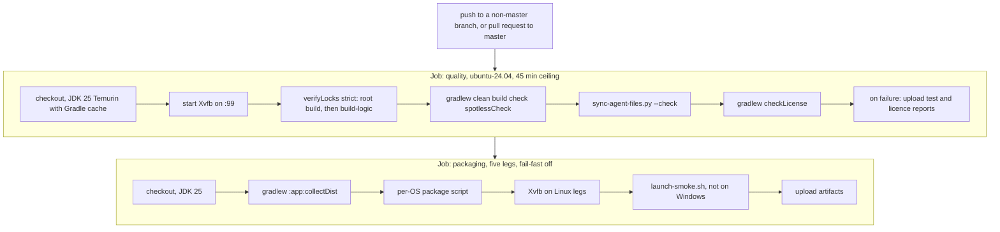

# CI, hooks and the quality gate

Everything here is read from `.github/workflows/ci.yml`, `lefthook.yml`, `.lefthook/pre-push/`, `tooling/hooks/`,
`build.gradle.kts` and the convention plugins in `modules/build-logic/`. For the shorter how-to see
[development/quality-and-ci.md](../development/quality-and-ci.md).

## The one rule

The local gate and the CI quality step are the same command:

```bash
./gradlew clean build check spotlessCheck
```

`.lefthook/pre-push/quality-gate.sh` runs it and the "Quality gate" step of CI runs it, with no extra flags. A green
push therefore means a green CI quality step for the same tree. CI may add gates (the licence check, the agent-config
check, the packaging matrix) but must not run a weaker or different version of the shared command. A clean run took
17m 45s to 20m 17s in the measurements recorded in [`AGENTS.md`](../../AGENTS.md); the CI file's own comment says 15 to
27 minutes on the runner, and sets a 45-minute ceiling. A run much longer than the last baseline is treated as hung.

## What actually exists in `.github/`

Only one workflow file: `.github/workflows/ci.yml`, named "CI". The comments inside it mention a `build.yml` (snapshot
packaging on `master`) and a `release.yml` (tag to GitHub Release) that "arrive with the packaging change". Neither
file exists. There is no release workflow, and nothing runs on a push to `master` (see triggers below).

## Triggers and settings

| Setting | Value |
|---|---|
| `pull_request` | branches `master` |
| `push` | all branches except `master` (`branches-ignore: [master]`) |
| Concurrency | group `ci-<workflow>-<ref>`, `cancel-in-progress: true`: a new push to a ref cancels its earlier run |
| Permissions | `contents: read` only |
| Actions | pinned to full commit SHAs with the tag in a comment (checkout v7.0.1, setup-java v5.7.0, upload-artifact v7.0.1) |
| Branch protection | not described in any repository file; `AGENTS.md` states `master` is protected and merged by the owner |

## Jobs



### `quality` (name "Quality gate")

Runs on `ubuntu-24.04`, `timeout-minutes: 45`.

| Step | What it does | Local equivalent |
|---|---|---|
| Check out | `actions/checkout` | |
| Set up JDK 25 (Temurin) | Gradle cache keyed on `gradle/wrapper/gradle-wrapper.properties`, `gradle/libs.versions.toml` and `**/*.lockfile` | |
| Start Xvfb | virtual display `:99` (installs `xvfb` if absent) and exports `DISPLAY`. The TestFX suites do not need it (JavaFX 26 headless platform); it guards incidental AWT or toolkit use | |
| Verify dependency lock state (strict) | `./gradlew --no-daemon -PstrictLocks verifyLocks` and the same with `-p modules/build-logic`. Strict mode also fails a configuration that has no lock state at all. Runs before the gate so a lock problem fails in seconds | `./gradlew -PstrictLocks verifyLocks` |
| Quality gate | `./gradlew clean build check spotlessCheck` (below) | `.lefthook/pre-push/quality-gate.sh` |
| Agent config sync check | `python3 scripts/sync-agent-files.py --check` | `.lefthook/pre-push/agent-config-sync.sh` |
| License gate | `./gradlew checkLicense`: every runtime dependency's licence must be in `config/license/allowed-licenses.json`; the check needs the network to resolve POM metadata, so it is CI-only | `./gradlew checkLicense` (needs network) |
| Upload test reports | only on failure; artifact `test-reports-<run id>`: HTML and XML test reports, Checkstyle and SpotBugs reports; 14 days | |
| Upload license gate reports | only on failure; artifact `dependency-reports-<run id>`: `build/reports/dependency-license/**`; 14 days | |

What the gate command covers (from the convention plugins and `modules/app/build.gradle.kts`):

| Check | Where it is defined |
|---|---|
| Spotless (Palantir Java Format, unused imports, trailing whitespace) | `bookloom.spotless-conventions` |
| Checkstyle, zero warnings | `bookloom.java-conventions`, `config/checkstyle/` |
| Error Prone with NullAway as errors, `-Xlint:all -Werror` | `bookloom.java-conventions` |
| SpotBugs with FindSecBugs, effort max, report level high | `bookloom.java-conventions`, `config/spotbugs/exclude.xml` |
| Tests: every tag except `liveLocal`, `promptEval`, `visual`, `corpus`, `soak`; forked in parallel (half the cores, at most four) | `bookloom.test-conventions` |
| JaCoCo branch coverage 0.80 per module | `bookloom.coverage-conventions` |
| ArchUnit boundary suite `:app:archTest` | `modules/app/build.gradle.kts` |

### `packaging` (name "Package (target)")

`needs: quality`, so it starts only after the quality job is green. It also runs on every push and pull request that
triggers the workflow, not only on release. Five legs, `fail-fast: false`, 45-minute ceiling each:

| Leg | Runner | JDK | Script |
|---|---|---|---|
| macos-aarch64 | `macos-15` | Temurin | `./scripts/package-macos.sh` |
| macos-x86_64 | `macos-15-intel` | Temurin | `./scripts/package-macos.sh` |
| linux-x86_64 | `ubuntu-24.04` | Temurin | `./scripts/package-linux.sh` |
| linux-aarch64 | `ubuntu-24.04-arm` | Temurin | `./scripts/package-linux.sh` |
| windows-x86_64 | `windows-2025` | Liberica (jdk+fx) | `scripts\package-windows.bat` |

Steps per leg: check out, set up JDK 25, `./gradlew :app:collectDist` (stages the app jar and runtime classpath in
`modules/app/build/dist/libs`), run the package script, start Xvfb (Linux only), `./scripts/launch-smoke.sh` (skipped
on Windows), then upload artifacts. The upload glob is `build/package/*.tar.gz`, `*.dmg` and `*.deb`, retention 14
days, `if-no-files-found: warn`; the Windows leg produces a folder, not an archive, so it uploads nothing. See
[release-and-packaging.md](release-and-packaging.md).

The packaging matrix ran green on every leg for the pull-request run of 2026-10-27. The run of 2026-11-08 failed
at the quality job's strict lock verification (a build-script dependency, `kotlinx-coroutines-bom` 1.8.0, had no
checksum entry in `gradle/verification-metadata.xml` on the Linux runner), so the packaging legs did not start; the
entry was added at the end of the redesign change. The run of 2026-11-12 (the archive push) was green on the quality job (30m) and all five packaging legs.

### What CI does not run

`liveLocal`, `promptEval`, `visual`, `corpus` and `soak` (excluded from `check` by the task graph; they need a real
model, a pinned display or the owner's books), Sonar, and `scripts/ci-linux-ui.sh`. The secret scan (gitleaks) is a local
pre-commit hook only; CI has no secret-scan step.

## Git hooks (Lefthook)

Hooks are not active until `lefthook install` is run once per clone; `gitleaks` must be on the `PATH`.

| Stage | Jobs | Budget |
|---|---|---|
| `pre-commit` (sequential) | `format`: `./gradlew spotlessApply` when a `*.java` file is staged, then re-stages those files. `secrets`: `gitleaks git --pre-commit --staged --redact --no-banner`. `file-size`: `sh tooling/hooks/file-size-guard.sh {staged_files}` (4096 KB, override `BOOKLOOM_MAX_FILE_SIZE_KB`) | under 10 s, no tests |
| `commit-msg` | `conventional-commit`: `sh tooling/hooks/conventional-commit.sh {1}` | instant |
| `pre-push` | two `scripts:` entries: `quality-gate.sh` (the full gate) and `agent-config-sync.sh` | the full gate |

Pre-push uses `scripts:` and not `jobs:` because Lefthook skips pre-push jobs whose `{push_files}` list is empty,
which happens on ordinary pushes; scripts are not filtered. Keep it that way. Escape hatches:
`git commit --no-verify`, `git push --no-verify`, `LEFTHOOK=0 git <cmd>`. They are a decision, not a habit, and
`AGENTS.md` forbids agents from using `--no-verify`.

## Linux UI check

Window text is measured with the platform font, so a fit test that passes on macOS can fail on the Ubuntu runner
(run 40489525598 had 199 failures). Before pushing a change to a screen, dialog or UI word run
`scripts/ci-linux-ui.sh` (Docker, for example Colima). Layout rules that hold on both: `Wrapped.wholeLines` for
wrapping labels, `setMinWidth(Region.USE_PREF_SIZE)` for buttons and chips that must stay whole, `FlowPane` for a row
that can run out of room. Push after each step group rather than many commits at once.

## SonarQube (local, opt-in)

```bash
SONAR_HOST_URL=http://localhost:9000 SONAR_TOKEN=... ./gradlew sonar -PsonarLocal
```

Needs the owner's local SonarQube server; project key `local:bookloom`. `gradle/sonar-coverage.gradle.kts` builds a
combined JaCoCo XML report (`sonarCoverageReport`, which requires `-PsonarLocal`) and `:app:compileArchTestJava` is a
dependency of the `sonar` task. `build`, `check`, hooks and CI never run it. The Definition of Done asks for it after
the gate at the end of each change group, with 0 open issues and the quality gate OK. Keep the token out of files.

## Licence and secret checks

| Check | Where | Notes |
|---|---|---|
| Licence allowlist | `./gradlew checkLicense`, CI only | scoped to each subproject's `runtimeClasspath`, so build tooling and test libraries are outside it; policy and the reason for each entry in `config/license/README.md`; reports `THIRD-PARTY-NOTICES` and an HTML inventory under `build/reports/dependency-license/` |
| Vulnerability scan | none | an OWASP dependency check was dropped on 2026-09-11 (comment in `ci.yml` and `build.gradle.kts`) |
| Secret scan | gitleaks in the pre-commit hook | staged diff only |
| Dependency integrity | `gradle/verification-metadata.xml`, lockfiles, `verifyLocks` | |
