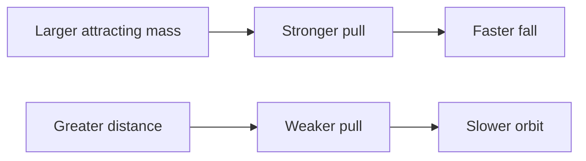
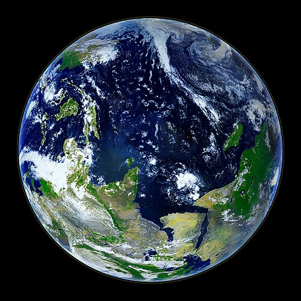
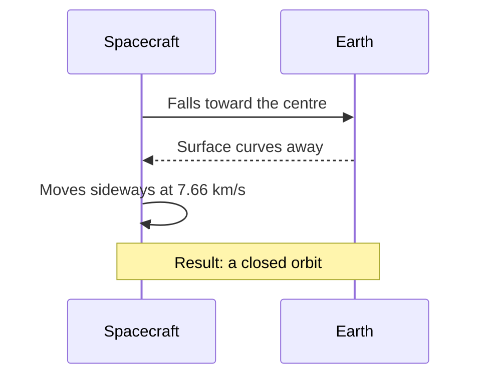

<!-- Test article for multilingual translation. Source language: English. Table-of-contents anchors follow the headings of each language. -->

# The Quiet Pull: How Gravity Shapes Our World

> **In brief:** Gravity is the weakest of the fundamental forces, yet it decides the shape of planets, the paths of satellites and the rhythm of the tides. This article follows the idea from a falling stone to a bending clock, explains the inverse-square law with a few simple numbers, and shows why astronauts on the space station are not, in fact, beyond the reach of Earth.

*By the editorial team · Published 2026-10-28 · Reading time: about 12 minutes*

---

## Contents

- [1. Why Things Fall](#1-why-things-fall)
- [2. A Short History of a Long Idea](#2-a-short-history-of-a-long-idea)
- [3. The Inverse-Square Law](#3-the-inverse-square-law)
- [4. Weighing the Earth](#4-weighing-the-earth)
- [5. Gravity Is Not the Same Everywhere](#5-gravity-is-not-the-same-everywhere)
- [6. Falling Around the Planet](#6-falling-around-the-planet)
- [7. When Space Bends](#7-when-space-bends)
- [8. Measuring Gravity Today](#8-measuring-gravity-today)
- [9. Try It Yourself](#9-try-it-yourself)
- [References](#references)

---

## 1. Why Things Fall

Drop a key.

It falls. Of course it does — and yet the question of *why* it falls kept some of the sharpest minds in history busy for more than two thousand years. The answer we accept today is deceptively simple: every object that has mass attracts every other object that has mass, and the larger the masses involved, the stronger the attraction becomes.

For two apples on a kitchen table, that pull is so feeble that no ordinary instrument could ever detect it. Earth, however, is not an apple. With a mass of about 5.972 × 10²⁴ kg, our planet pulls on everything near its surface hard enough to make a dropped object speed up by roughly 9.81 m/s² — that is, its downward speed grows by almost ten metres per second with every second of fall, as long as air resistance can be ignored.

Four terms are worth separating before we go further:

- **Mass** — the amount of matter in an object, measured in kilograms; it stays the same wherever you take the object.
- **Weight** — the force with which gravity pulls on that mass, measured in newtons; it changes from place to place.
- **Free fall** — motion under the influence of gravity alone, with no other force acting on the object.
- **Gravitational field** — the region around a mass in which another mass feels its pull.

An astronaut who weighs 785 N at home weighs only about 130 N on the Moon, but she has not lost a single gram. Her mass is still 80 kg; only the pull has changed.

## 2. A Short History of a Long Idea

Who first asked the right question? Probably nobody we could name. But a handful of people turned the question into science, and their names appear in almost every textbook:

1. **Galileo Galilei** (1564–1642) showed that, without air in the way, heavy and light bodies fall at the same rate.
2. **Isaac Newton** (1643–1727) proposed a single law that explained both falling apples and orbiting moons.
3. **Henry Cavendish** (1731–1810) measured the attraction between lead spheres in a laboratory.
4. **Loránd Eötvös** (1848–1919) tested, with astonishing precision, whether all materials fall alike.
5. **Albert Einstein** (1879–1955) reinterpreted gravity as the curvature of space and time.

Newton himself was careful about what he claimed. He described *how* gravity behaves with great mathematical exactness, but he refused to invent a mechanism he could not observe. In the second edition of his *Principia* he summed up this attitude in a famous Latin phrase, *"Hypotheses non fingo"* — "I frame no hypotheses" — which a translator should leave in Latin, exactly as Newton wrote it.

It is worth pausing on how strange his proposal must have sounded. Newton was saying that the force which makes a pebble tumble from a cliff in Lincolnshire is precisely the same force that keeps the Moon swinging around the Earth once every 27 days, and that one tidy formula, written on a single line, could predict both motions to within the accuracy of the best astronomical tables of his day.

Not everyone was convinced. Some critics called the idea "action at a distance" and found it close to magic. They were not entirely wrong to be uneasy; the deeper explanation would have to wait more than two centuries.

## 3. The Inverse-Square Law

Newton's law of universal gravitation can be written in one line:

```text
F = G · (m₁ · m₂) / r²
```

Here `F` is the force between two bodies, `m₁` and `m₂` are their masses, `r` is the distance between their centres, and `G` is the gravitational constant. In proper typeset form the same law reads:

$$
F = G \frac{m_1 m_2}{r^2}, \qquad g = \frac{G M_\oplus}{R_\oplus^2} \approx 9.81\ \mathrm{m\,s^{-2}}
$$

The key feature is the square in the denominator. Double the distance, and the force does not drop by half — it drops to a quarter. Triple it, and only a ninth remains.

| Distance from Earth's centre | Example location            | Relative pull | Approx. `g` (m/s²) |
|:-----------------------------|:----------------------------|--------------:|-------------------:|
| 1 × `R⊕`                     | Sea level                   |        100 % |               9.81 |
| 1.06 × `R⊕`                  | International Space Station |         89 % |               8.73 |
| 2 × `R⊕`                     | Medium Earth orbit          |         25 % |               2.45 |
| 4 × `R⊕`                     | Just below GPS orbits       |       6.25 % |               0.61 |
| 60.3 × `R⊕`                  | Distance of the Moon        |     0.0275 % |             0.0027 |

The picture below shows the same idea in a form you could draw on a napkin. The lines of force spread out over a growing area, so each square metre receives fewer of them:

```text
                 r            2r                3r
   ●  ───────────┼─────────────┼─────────────────┼
 mass            │  1 square   │    4 squares    │   9 squares
                 │  full pull  │   1/4 the pull  │   1/9 the pull
```

The relationship can also be summarised as a simple flow:



## 4. Weighing the Earth

Knowing the shape of the law is one thing. Knowing the value of `G` is another, and without it nobody could say how massive the Earth actually is.

In 1797 and 1798 Henry Cavendish set up an instrument called a torsion balance in an outbuilding at his home in London. A wooden rod carrying two small lead balls hung from a thin wire; two much larger lead spheres were brought close to the small ones, and the tiny gravitational tug between them twisted the wire by an angle that Cavendish read through a telescope from outside the room, so that the warmth of his own body would not disturb the air. From that minute twist he worked out the density of the Earth, and from the density its mass — and from his data later physicists extracted the first respectable value of the gravitational constant.

The modern recommended value is:

```text
G = 6.674 30(15) × 10⁻¹¹ m³ kg⁻¹ s⁻²
```

Strikingly, `G` is still the least precisely known of the fundamental constants. Its relative uncertainty is about 22 parts per million, far worse than that of the speed of light or the charge of the electron. Experiments that cost upwards of $250,000 (roughly €230,000) still disagree with each other in the fourth significant figure.

Cavendish's apparatus inspired a long line of successors. One of them, the fictional Dr. Ilse Vorwerk of our story, kept a torsion balance in a cellar in Göttingen for eleven winters. In a (fictional) letter to a younger colleague, she wrote: *„Die Waage lügt nie; wir sind nur zu ungeduldig, um ihr zuzuhören.“* — "The balance never lies; we are simply too impatient to listen to it." The German sentence should stay in German.


> [!NOTE]
> A torsion balance is extremely sensitive. A person walking past the building, a passing lorry or a change in room temperature of only 0.1 °C can swamp the signal entirely.

## 5. Gravity Is Not the Same Everywhere

If you have always assumed that `9.81` is a law of nature, prepare for a small disappointment. It is a rounded reference value.

Our planet is not a perfect sphere, and it is not standing still. Several effects combine to make the local value of `g` slightly different from one place to the next:

- Latitude and rotation
  - At the equator, the spin of the Earth partly offsets gravity.
    - Measured value: about 9.780 m/s².
    - At the poles: about 9.832 m/s², roughly 0.5 % more.
  - The planet bulges at the equator by about 21 km.
- Altitude
  - On the summit of a high mountain you are farther from the centre.
    - The loss is about 0.3 % for every 10 km of height.
- Local geology
  - Dense ore bodies raise `g`; salt domes and sediment basins lower it.

None of these effects is large, and none of them is something you could feel: no person standing at the pole or the equator would ever notice the difference, and an ordinary bathroom scale would barely register it, although no well-calibrated gravimeter would fail to record it.

The variations are small, yet they are not without consequence. Geologists map them to find oil, water and minerals; satellite missions map them to watch ice sheets shrink and groundwater drain away.



*Figure 1. Earth seen from space. The planet looks perfectly round, but its equatorial diameter exceeds its polar diameter by about 43 km.*

## 6. Falling Around the Planet

Why do astronauts float? Many people believe that there is no gravity in orbit. There is plenty. At the height of the International Space Station, about 400 km above the surface, gravity is still close to 89 % as strong as it is on the ground.

The astronauts float because they, their spacecraft and every loose pen on board are all falling together. They move sideways so fast — about 7.66 km/s — that as they fall, the curved surface of the Earth drops away beneath them at the same rate. They are falling *around* the planet, never into it.

A fictional cosmonaut in our test story, Oksana Hrytsenko, put it neatly over the radio on her first day aboard: «Тут ніщо не падає — усе просто летить разом зі мною.» In English: "Nothing falls up here — everything simply flies along with me." Her words, in Ukrainian, should be left exactly as she spoke them.



<details>
<summary>How fast would you need to go to leave the Earth for good?</summary>

To escape completely, without any further push, an object at the surface would need about 11.2 km/s. That figure, called the *escape velocity*, does not depend on the mass of the object itself — a grain of sand and a cargo ship need the same speed.

</details>

## 7. When Space Bends

For more than two hundred years Newton's law worked almost perfectly. Almost. The closest point of Mercury's orbit drifted by a tiny extra amount — 43 arcseconds per century — that no arrangement of known planets could explain.

In 1915 Albert Einstein published the general theory of relativity, and with it a completely new picture: mass and energy curve space and time, and objects moving freely simply follow the straightest possible paths through that curved geometry. What Newton called a force, Einstein described as the shape of the stage itself. The new theory accounted for Mercury's drift without any adjustment, predicted that starlight would bend as it passed the Sun, and implied — most strangely of all — that clocks closer to a large mass tick more slowly than clocks farther away.

Is this just theory? Hardly. Every satellite navigation receiver depends on it. The clocks on GPS satellites gain about 45 microseconds a day because they sit higher in Earth's gravity and lose about 7 because they move fast; the net gain of 38 µs per day would, if left uncorrected, shift a position fix by roughly 10 km within a single day.

A retired French physics teacher, the fictional Mme Hélène Garnier, liked to open her lessons with a line of her own: « La pomme ne tombe pas : elle suit simplement le chemin le plus droit. » — "The apple does not fall: it simply follows the straightest path." The French should remain in French.

> [!WARNING]
> Do not try to "test" free fall with valuable objects, from heights, or near other people. A phone dropped from 2 m hits the floor at about 6.3 m/s, which is more than enough to crack its screen.

## 8. Measuring Gravity Today

Modern instruments do things that would have amazed Cavendish. An absolute gravimeter drops a mirror inside a vacuum chamber and tracks it with a laser; a superconducting gravimeter floats a niobium sphere in a magnetic field; atom interferometers use clouds of cold atoms as their test masses.

| Instrument               | Principle               | Typical precision       | Example output field |
|:-------------------------|:------------------------|------------------------:|:---------------------|
| Spring gravimeter        | Stretched spring        |    10 µGal              | `g_rel`              |
| Absolute gravimeter      | Free-falling mirror     |     2 µGal              | `g_abs`              |
| Superconducting gravimeter | Levitated sphere    |   0.1 µGal              | `g_sc`               |
| Satellite pair (orbiting) | Distance between craft | about 1 µm              | `range`              |

One microgal (µGal) is 10⁻⁸ m/s², or about one billionth of the gravity you feel right now.

A field team's checklist for a single survey day might look like this:

- [x] Charge the gravimeter batteries overnight
- [x] Record the base-station reading at 08:00 UTC
- [ ] Repeat the base reading after every 10 stations
- [ ] Back up the data before leaving the site

Survey data are usually stored in a plain folder structure, something like:

```text
survey-2026-10-28/
├── base/
│   └── base_station.csv
├── stations/
│   ├── st_001.csv
│   └── st_002.csv
└── README.txt
```

and each station is described by a small metadata file:

```json
{
  "station_id": "st_001",
  "date": "2026-10-28",
  "latitude_deg": 50.4501,
  "elevation_m": 179.0,
  "g_mGal": 981045.37,
  "instrument": "CG-6",
  "operator": "field_team_b"
}
```

## 9. Try It Yourself

You do not need a laboratory to see the inverse-square law at work. A few lines of Python are enough:

```python
G = 6.67430e-11        # gravitational constant, m^3 kg^-1 s^-2
EARTH_MASS = 5.972e24  # kg
EARTH_RADIUS = 6.371e6 # m

def surface_gravity(mass_kg: float, radius_m: float) -> float:
    """Return the gravitational acceleration at the given radius."""
    return G * mass_kg / radius_m**2

for factor in (1, 2, 3, 4):
    g = surface_gravity(EARTH_MASS, EARTH_RADIUS * factor)
    print(f"{factor} x R: g = {g:.2f} m/s^2")
```

Save it as `gravity.py`, then run it from a terminal:

```bash
python3 gravity.py
# expected first line:
# 1 x R: g = 9.82 m/s^2
```

On most systems you can stop a running script with <kbd>Ctrl</kbd>+<kbd>C</kbd>. If you would rather not type, copy the code with <kbd>⌘</kbd>+<kbd>C</kbd> and paste it into an online notebook.

Notice that the script prints 9.82 rather than 9.81. That is not a bug. The formula ignores Earth's rotation, which trims up to 0.03 m/s² at the equator, and it treats the planet as a perfect sphere.

A few honest caveats about home experiments:

3. Air resistance matters far more than most people expect; a sheet of paper and a coin will not land together, although crumpling the paper into a ball brings them much closer.
4. Reaction time is the enemy of timing a fall by hand — it is usually about 0.2 s, comparable to a whole fall from a tabletop.
5. Rulers and phone sensors have errors of their own, so repeat each measurement at least five times.

For the curious, the time it takes an object to fall a height `h` from rest is `t = √(2h / g)`; from a height of 1.5 m that comes to about 0.55 s.\
Short, isn't it?

A small typographic reminder for anyone editing this file: the symbols \* and \_ are written with a backslash here so that they always appear literally, as in 2 \* 3 and file\_name, and can never turn text into *italics* or **bold**. Older drafts of this article claimed that ~~gravity is exactly 9.8 m/s² everywhere~~; the tables above now give ***more precise figures***.

---

## References

1. Newton, I. *The Principia: Mathematical Principles of Natural Philosophy.* Trans. I. B. Cohen and A. Whitman. University of California Press, 1999. ISBN 978-0-000-00000-2.
2. Cavendish, H. "Experiments to Determine the Density of the Earth." *Philosophical Transactions of the Royal Society of London* 88 (1798): 469–526. doi:[10.5555/rstl.1798.0022](https://doi.org/10.5555/rstl.1798.0022)
3. Tiesinga, E., et al. "CODATA recommended values of the fundamental physical constants: 2018." *Reviews of Modern Physics* 93, 025010 (2021). doi:[10.5555/RevModPhys.93.025010](https://doi.org/10.5555/RevModPhys.93.025010)
4. NASA Science, "Earth" overview: https://example.org/nasa-science/earth/
5. Background on space science, orbits included, is available from [the European Space Agency][esa].

Corrections and questions are welcome at [editor@example.org](mailto:editor@example.org). The figure of 9.81 m/s² used throughout follows the conventional rounding of the standard value 9.806 65 m/s²<sup>3</sup>.

[esa]: https://www.esa.int/Science_Exploration "European Space Agency — Science & Exploration"

---

<!-- metadata: keep this footer unchanged in every language -->
**Document version:** `2.1.0` · **Last revised:** 2026-10-28 · **Format:** GitHub Flavored Markdown · **Licence:** CC BY 4.0 · **ID:** `bl-test-gravity-en`
