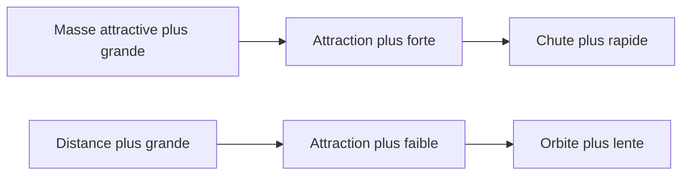
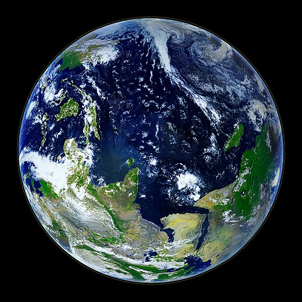
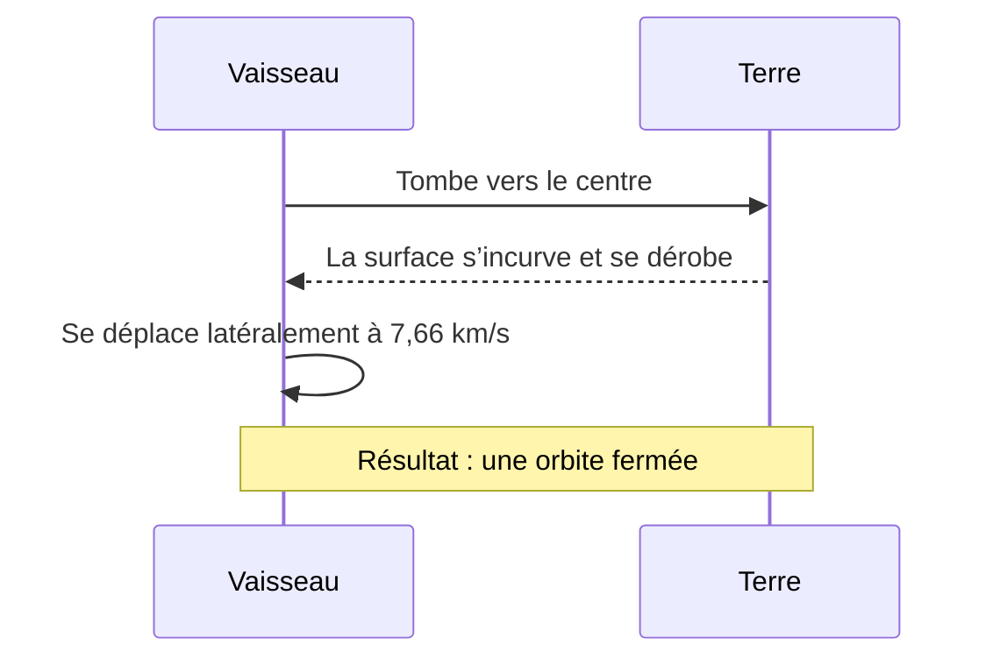

<!-- Test article for multilingual translation. Source language: English. Table-of-contents anchors follow the headings of each language. -->

# L’attraction discrète : comment la gravitation façonne notre monde

> **En bref :** La gravitation est la plus faible des interactions fondamentales, et c’est pourtant elle qui décide de la forme des planètes, de la trajectoire des satellites et du rythme des marées. Cet article suit le fil de l’idée, de la pierre qui tombe à l’horloge que l’espace-temps fait ralentir, explique la loi de l’inverse du carré à l’aide de quelques chiffres simples et montre pourquoi les astronautes de la station spatiale n’échappent nullement, en réalité, à l’emprise de la Terre.

*Par la rédaction · Publié le 2026-10-28 · Temps de lecture : environ 12 minutes*

---

## Sommaire

- [1. Pourquoi les objets tombent](#1-pourquoi-les-objets-tombent)
- [2. Brève histoire d’une longue idée](#2-brève-histoire-dune-longue-idée)
- [3. La loi de l’inverse du carré](#3-la-loi-de-linverse-du-carré)
- [4. Peser la Terre](#4-peser-la-terre)
- [5. La pesanteur n’est pas la même partout](#5-la-pesanteur-nest-pas-la-même-partout)
- [6. Tomber autour de la planète](#6-tomber-autour-de-la-planète)
- [7. Quand l’espace se courbe](#7-quand-lespace-se-courbe)
- [8. Mesurer la pesanteur aujourd’hui](#8-mesurer-la-pesanteur-aujourdhui)
- [9. À vous d’essayer](#9-à-vous-dessayer)
- [Références](#références)

---

## 1. Pourquoi les objets tombent

Lâchez une clé.

Elle tombe. Évidemment — et pourtant, la question de savoir *pourquoi* elle tombe a occupé certains des esprits les plus brillants de l’histoire pendant plus de deux mille ans. La réponse que nous admettons aujourd’hui est d’une simplicité trompeuse : tout objet doté d’une masse attire tout autre objet doté d’une masse, et plus les masses en jeu sont grandes, plus l’attraction est forte.

Entre deux pommes posées sur une table de cuisine, cette attraction est si ténue qu’aucun instrument ordinaire ne pourrait jamais la déceler. Mais la Terre n’est pas une pomme. Avec une masse d’environ 5,972 × 10²⁴ kg, notre planète attire tout ce qui se trouve près de sa surface avec assez de force pour qu’un objet lâché accélère d’environ 9,81 m/s² : autrement dit, sa vitesse de chute augmente de près de dix mètres par seconde à chaque seconde, tant que l’on peut négliger la résistance de l’air.

Avant d’aller plus loin, il convient de bien distinguer quatre notions :

- **Masse** — la quantité de matière que contient un objet, exprimée en kilogrammes ; elle reste la même où que l’on emporte l’objet.
- **Poids** — la force avec laquelle la pesanteur attire cette masse, exprimée en newtons ; il varie d’un endroit à l’autre.
- **Chute libre** — mouvement d’un corps soumis à la seule gravitation, sans qu’aucune autre force n’agisse sur lui.
- **Champ gravitationnel** — région de l’espace entourant une masse, dans laquelle une autre masse subit son attraction.

Une astronaute qui pèse 785 N sur Terre ne pèse plus qu’environ 130 N sur la Lune, et pourtant elle n’a pas perdu un seul gramme. Sa masse est toujours de 80 kg ; seule l’attraction a changé.

## 2. Brève histoire d’une longue idée

Qui a, le premier, posé la bonne question ? Sans doute personne dont nous connaissions le nom. Mais une poignée de savants ont fait de cette question une science, et leurs noms figurent dans presque tous les manuels :

1. **Galilée** (1564–1642) a montré qu’en l’absence d’air, les corps lourds et les corps légers tombent avec la même accélération.
2. **Isaac Newton** (1643–1727) a proposé une loi unique qui expliquait à la fois la chute des pommes et la révolution des lunes sur leur orbite.
3. **Henry Cavendish** (1731–1810) a mesuré en laboratoire l’attraction qui s’exerce entre des sphères de plomb.
4. **Loránd Eötvös** (1848–1919) a vérifié, avec une précision stupéfiante, si tous les matériaux tombent de la même façon.
5. **Albert Einstein** (1879–1955) a réinterprété la gravitation comme une courbure de l’espace et du temps.

Newton lui-même pesait soigneusement ses affirmations. Il décrivait avec une grande rigueur mathématique *comment* se comporte la gravitation, mais se refusait à inventer un mécanisme qu’il ne pouvait pas observer. Dans la deuxième édition de ses *Principia*, il résuma cette attitude par une célèbre formule latine, *« Hypotheses non fingo »* (« je ne forge pas d’hypothèses »), qu’un traducteur doit laisser en latin, exactement telle que Newton l’a écrite.

On mesure mal aujourd’hui à quel point sa proposition a dû paraître étrange. Newton affirmait que la force qui fait dégringoler un caillou du haut d’une falaise du Lincolnshire est exactement la même que celle qui fait tourner la Lune autour de la Terre en 27 jours, et qu’une seule formule, aussi nette que concise, tenant sur une ligne, permettait de prédire ces deux mouvements avec toute la précision des meilleures tables astronomiques de son temps.

Tout le monde ne fut pas convaincu. Certains critiques parlaient d’« action à distance » et y voyaient quelque chose de proche de la magie. Leur malaise n’était pas tout à fait injustifié : l’explication profonde allait se faire attendre plus de deux siècles.

## 3. La loi de l’inverse du carré

La loi de la gravitation universelle de Newton tient en une ligne :

```text
F = G · (m₁ · m₂) / r²
```

Ici, `F` est la force qui s’exerce entre deux corps, `m₁` et `m₂` sont leurs masses, `r` est la distance entre leurs centres et `G` la constante gravitationnelle. Sous sa forme typographique soignée, la même loi s’écrit :

$$
F = G \frac{m_1 m_2}{r^2}, \qquad g = \frac{G M_\oplus}{R_\oplus^2} \approx 9.81\ \mathrm{m\,s^{-2}}
$$

Tout tient au carré du dénominateur. Doublez la distance, et la force n’est pas divisée par deux : elle tombe au quart. Triplez-la, et il n’en reste qu’un neuvième.

| Distance au centre de la Terre | Exemple de lieu                 | Attraction relative | `g` approx. (m/s²) |
|:-------------------------------|:--------------------------------|--------------------:|-------------------:|
| 1 × `R⊕`                       | Niveau de la mer                |              100 % |               9,81 |
| 1,06 × `R⊕`                    | Station spatiale internationale |               89 % |               8,73 |
| 2 × `R⊕`                       | Orbite terrestre moyenne        |               25 % |               2,45 |
| 4 × `R⊕`                       | Juste sous les orbites GPS      |             6,25 % |               0,61 |
| 60,3 × `R⊕`                    | Distance de la Lune             |           0,0275 % |             0,0027 |

Le schéma ci-dessous traduit la même idée sous une forme que l’on pourrait griffonner sur une serviette en papier. Les lignes de force se répartissent sur une surface de plus en plus grande, si bien que chaque mètre carré en reçoit moins :

```text
                 r            2r                3r
   ●  ───────────┼─────────────┼─────────────────┼
 masse           │  1 carré    │    4 carrés     │   9 carrés
                 │ pleine force│ 1/4 de la force │   1/9 de la force
```

On peut aussi résumer cette relation par un schéma simple :



## 4. Peser la Terre

Connaître la forme de la loi est une chose. Connaître la valeur de `G` en est une autre, et sans elle personne ne pouvait dire quelle est réellement la masse de la Terre.

En 1797 et 1798, Henry Cavendish installa un instrument appelé balance de torsion dans une dépendance de sa maison de Londres. Une tige de bois portant deux petites boules de plomb était suspendue à un fil fin ; on approchait des petites boules deux sphères de plomb beaucoup plus grosses, et la minuscule attraction gravitationnelle qui s’exerçait entre elles tordait le fil d’un angle que Cavendish lisait à la lunette depuis l’extérieur de la pièce, afin que la chaleur de son propre corps ne vienne pas perturber l’air. De cette infime torsion, il déduisit la densité de la Terre, puis de cette densité sa masse — et c’est de ses données que des physiciens tirèrent plus tard la première valeur sérieuse de la constante gravitationnelle.

La valeur recommandée aujourd’hui est la suivante :

```text
G = 6.674 30(15) × 10⁻¹¹ m³ kg⁻¹ s⁻²
```

Fait remarquable, `G` reste la moins bien connue des constantes fondamentales. Son incertitude relative est d’environ 22 parties par million, bien pire que celle de la vitesse de la lumière ou de la charge de l’électron. Des expériences qui coûtent plus de 250 000 $ (environ 230 000 €) divergent encore entre elles dès le quatrième chiffre significatif.

L’appareil de Cavendish a inspiré une longue lignée de successeurs. Parmi eux, la docteure Ilse Vorwerk, personnage fictif de notre récit, fit fonctionner une balance de torsion dans une cave de Göttingen pendant onze hivers. Dans une lettre (fictive) adressée à un jeune collègue, elle écrivait : *„Die Waage lügt nie; wir sind nur zu ungeduldig, um ihr zuzuhören.“* — « La balance ne ment jamais ; c’est nous qui sommes trop impatients pour l’écouter. » La phrase allemande doit rester en allemand.


> [!NOTE]
> Une balance de torsion est extrêmement sensible. Un passant qui longe le bâtiment, un poids lourd qui circule à proximité ou une variation de la température de la pièce d’à peine 0,1 °C suffisent à noyer entièrement le signal.

## 5. La pesanteur n’est pas la même partout

Si vous avez toujours cru que `9.81` était une loi de la nature, préparez-vous à une petite déception. Ce n’est qu’une valeur de référence arrondie.

Notre planète n’est pas une sphère parfaite, et elle n’est pas immobile. Plusieurs effets se combinent pour que la valeur locale de `g` varie légèrement d’un endroit à l’autre :

- Latitude et rotation
  - À l’équateur, la rotation de la Terre compense en partie l’attraction gravitationnelle.
    - Valeur mesurée : environ 9,780 m/s².
    - Aux pôles : environ 9,832 m/s², soit près de 0,5 % de plus.
  - La planète est renflée à l’équateur d’environ 21 km.
- Altitude
  - Au sommet d’une haute montagne, on se trouve plus loin du centre.
    - La perte est d’environ 0,3 % tous les 10 km d’altitude.
- Géologie locale
  - Les gisements de minerai denses augmentent `g` ; les dômes de sel et les bassins sédimentaires le diminuent.

Aucun de ces effets n’est important, et aucun n’est perceptible : personne, debout au pôle ou à l’équateur, ne remarquerait jamais la différence, et un pèse-personne ordinaire la décèlerait à peine, alors qu’un gravimètre bien étalonné, lui, ne manquerait pas de l’enregistrer.

Ces variations sont faibles, mais elles ne sont pas sans conséquences. Les géologues les cartographient pour trouver du pétrole, de l’eau et des minerais ; les missions satellitaires les cartographient pour suivre le recul des calottes glaciaires et l’épuisement des nappes souterraines.



*Figure 1. La Terre vue de l’espace. La planète paraît parfaitement ronde, mais son diamètre équatorial dépasse son diamètre polaire d’environ 43 km.*

## 6. Tomber autour de la planète

Pourquoi les astronautes flottent-ils ? Beaucoup de gens croient qu’il n’y a pas de pesanteur en orbite. Il y en a pourtant largement. À l’altitude de la Station spatiale internationale, à quelque 400 km au-dessus de la surface, la pesanteur atteint encore près de 89 % de sa valeur au sol.

Si les astronautes flottent, c’est qu’eux-mêmes, leur vaisseau et le moindre stylo qui traîne à bord tombent tous ensemble. Ils se déplacent latéralement si vite — à environ 7,66 km/s — que, pendant leur chute, la surface courbe de la Terre se dérobe sous eux au même rythme. Ils tombent *autour* de la planète, sans jamais tomber dessus.

Une cosmonaute fictive de notre récit d’essai, Oksana Hrytsenko, l’a joliment résumé à la radio lors de sa première journée à bord : «Тут ніщо не падає — усе просто летить разом зі мною.» En français : « Ici, rien ne tombe — tout vole simplement avec moi. » Ses paroles, en ukrainien, doivent être laissées exactement telles qu’elle les a prononcées.



<details>
<summary>À quelle vitesse faudrait-il aller pour quitter la Terre pour de bon ?</summary>

Pour s’échapper complètement, sans aucune poussée supplémentaire, un objet situé à la surface devrait atteindre environ 11,2 km/s. Cette valeur, appelée *vitesse de libération*, ne dépend pas de la masse de l’objet lui-même : un grain de sable et un cargo ont besoin de la même vitesse.

</details>

## 7. Quand l’espace se courbe

Pendant plus de deux cents ans, la loi de Newton a fonctionné presque parfaitement. Presque. Le point de l’orbite de Mercure le plus proche du Soleil dérivait d’une infime quantité supplémentaire — 43 secondes d’arc par siècle — qu’aucune configuration des planètes connues ne parvenait à expliquer.

En 1915, Albert Einstein publia la théorie de la relativité générale, et avec elle une image entièrement nouvelle : la masse et l’énergie courbent l’espace et le temps, et les objets en mouvement libre suivent simplement les trajectoires les plus droites possible dans cette géométrie courbe. Ce que Newton appelait une force, Einstein le décrivait comme la forme même de la scène. La nouvelle théorie rendait compte de la dérive de Mercure sans le moindre ajustement, prédisait que la lumière des étoiles serait déviée en passant près du Soleil et impliquait — chose plus étrange encore — que les horloges proches d’une grande masse battent plus lentement que les horloges plus éloignées.

Simple vue de l’esprit ? Loin de là. Tout récepteur de navigation par satellite en dépend. Les horloges des satellites GPS avancent d’environ 45 microsecondes par jour parce qu’elles se trouvent plus haut dans le champ de pesanteur terrestre, et retardent d’environ 7 parce qu’elles se déplacent vite ; l’avance nette de 38 µs par jour, si on ne la corrigeait pas, fausserait une position d’environ 10 km en une seule journée.

Une professeure de physique française à la retraite, Mme Hélène Garnier (personnage fictif), aimait ouvrir ses cours par une formule de son cru : « La pomme ne tombe pas : elle suit simplement le chemin le plus droit. » Le français doit rester en français.

> [!WARNING]
> N’essayez pas de « tester » la chute libre avec des objets de valeur, depuis une hauteur ou à proximité d’autres personnes. Un téléphone lâché d’une hauteur de 2 m heurte le sol à environ 6,3 m/s, ce qui suffit largement à fêler son écran.

## 8. Mesurer la pesanteur aujourd’hui

Les instruments modernes accomplissent des prouesses qui auraient émerveillé Cavendish. Un gravimètre absolu lâche un miroir dans une enceinte à vide et suit sa chute au laser ; un gravimètre supraconducteur fait léviter une sphère de niobium dans un champ magnétique ; les interféromètres atomiques utilisent des nuages d’atomes froids comme masses d’épreuve.

| Instrument                 | Principe                  | Précision typique       | Exemple de champ de sortie |
|:---------------------------|:--------------------------|------------------------:|:---------------------------|
| Gravimètre à ressort       | Ressort étiré             |    10 µGal              | `g_rel`                    |
| Gravimètre absolu          | Miroir en chute libre     |     2 µGal              | `g_abs`                    |
| Gravimètre supraconducteur | Sphère en lévitation      |   0,1 µGal              | `g_sc`                     |
| Paire de satellites (en orbite) | Distance entre les deux engins | environ 1 µm | `range`                    |

Un microgal (µGal) vaut 10⁻⁸ m/s², soit environ un milliardième de la pesanteur que vous ressentez en ce moment même.

Voici à quoi pourrait ressembler la liste de contrôle d’une équipe de terrain pour une journée de levé :

- [x] Charger les batteries du gravimètre pendant la nuit
- [x] Relever la mesure à la station de base à 08:00 UTC
- [ ] Répéter la mesure de base toutes les 10 stations
- [ ] Sauvegarder les données avant de quitter le site

Les données de levé sont généralement rangées dans une simple arborescence de dossiers, par exemple :

```text
survey-2026-10-28/
├── base/
│   └── base_station.csv
├── stations/
│   ├── st_001.csv
│   └── st_002.csv
└── README.txt
```

et chaque station est décrite par un petit fichier de métadonnées :

```json
{
  "station_id": "st_001",
  "date": "2026-10-28",
  "latitude_deg": 50.4501,
  "elevation_m": 179.0,
  "g_mGal": 981045.37,
  "instrument": "CG-6",
  "operator": "field_team_b"
}
```

## 9. À vous d’essayer

Nul besoin d’un laboratoire pour voir la loi de l’inverse du carré à l’œuvre. Quelques lignes de Python suffisent :

```python
G = 6.67430e-11        # constante gravitationnelle, m^3 kg^-1 s^-2
EARTH_MASS = 5.972e24  # kg
EARTH_RADIUS = 6.371e6 # m

def surface_gravity(mass_kg: float, radius_m: float) -> float:
    """Renvoie l'accélération de la pesanteur au rayon donné."""
    return G * mass_kg / radius_m**2

for factor in (1, 2, 3, 4):
    g = surface_gravity(EARTH_MASS, EARTH_RADIUS * factor)
    print(f"{factor} x R: g = {g:.2f} m/s^2")
```

Enregistrez-le sous le nom `gravity.py`, puis lancez-le depuis un terminal :

```bash
python3 gravity.py
# première ligne attendue :
# 1 x R: g = 9.82 m/s^2
```

Sur la plupart des systèmes, vous pouvez interrompre un script en cours d’exécution avec <kbd>Ctrl</kbd>+<kbd>C</kbd>. Si vous préférez ne pas taper le code, copiez-le avec <kbd>⌘</kbd>+<kbd>C</kbd> et collez-le dans un notebook en ligne.

Remarquez que le script affiche `9.82` et non 9,81. Ce n’est pas un bogue. La formule ne tient pas compte de la rotation de la Terre, qui retranche jusqu’à 0,03 m/s² à l’équateur, et elle traite la planète comme une sphère parfaite.

Quelques mises en garde, en toute honnêteté, à propos des expériences maison :

3. La résistance de l’air compte bien plus qu’on ne l’imagine ; une feuille de papier et une pièce de monnaie ne toucheront pas le sol en même temps, même si, en froissant le papier en boule, on réduit nettement l’écart.
4. Le temps de réaction est l’ennemi de quiconque chronomètre une chute à la main : il est généralement d’environ 0,2 s, soit une durée comparable à celle d’une chute entière depuis le haut d’une table.
5. Les règles et les capteurs des téléphones ont leurs propres erreurs ; répétez donc chaque mesure au moins cinq fois.

Pour les curieux, le temps que met un objet lâché sans vitesse initiale pour tomber d’une hauteur `h` vaut `t = √(2h / g)` ; d’une hauteur de 1,5 m, on obtient environ 0,55 s.\
Court, n’est-ce pas ?

Petit rappel typographique pour quiconque modifie ce fichier : les symboles \* et \_ sont précédés ici d’une barre oblique inverse pour s’afficher toujours tels quels, comme dans 2 \* 3 et file\_name, sans jamais pouvoir mettre le texte en *italique* ou en **gras**. D’anciennes versions de cet article affirmaient que ~~la pesanteur vaut exactement 9,8 m/s² partout~~ ; les tableaux ci-dessus donnent désormais des ***valeurs plus précises***.

---

## Références

1. Newton, I. *The Principia: Mathematical Principles of Natural Philosophy.* Trad. I. B. Cohen et A. Whitman. University of California Press, 1999. ISBN 978-0-000-00000-2.
2. Cavendish, H. « Experiments to Determine the Density of the Earth. » *Philosophical Transactions of the Royal Society of London* 88 (1798), p. 469–526. doi:[10.5555/rstl.1798.0022](https://doi.org/10.5555/rstl.1798.0022)
3. Tiesinga, E., et al. « CODATA recommended values of the fundamental physical constants: 2018. » *Reviews of Modern Physics* 93, 025010 (2021). doi:[10.5555/RevModPhys.93.025010](https://doi.org/10.5555/RevModPhys.93.025010)
4. NASA Science, présentation « Earth » : https://example.org/nasa-science/earth/
5. Des ressources sur les sciences spatiales, orbites comprises, sont proposées par [l’Agence spatiale européenne][esa].

Corrections et questions sont les bienvenues à l’adresse [editor@example.org](mailto:editor@example.org). La valeur de 9,81 m/s² utilisée tout au long de l’article correspond à l’arrondi conventionnel de la valeur normale de l’accélération de la pesanteur, 9,806 65 m/s²<sup>3</sup>.

[esa]: https://www.esa.int/Science_Exploration "Agence spatiale européenne — Science et exploration"

---

<!-- metadata: keep this footer unchanged in every language -->
**Document version:** `2.1.0` · **Last revised:** 2026-10-28 · **Format:** GitHub Flavored Markdown · **Licence:** CC BY 4.0 · **ID:** `bl-test-gravity-en`
