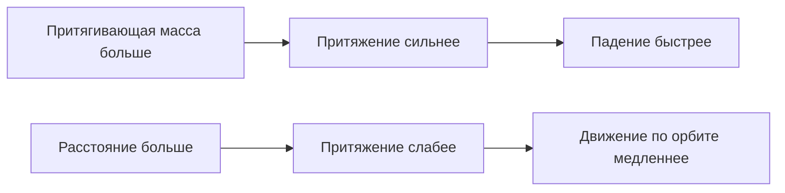
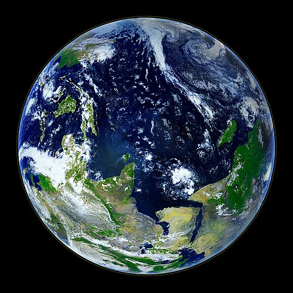
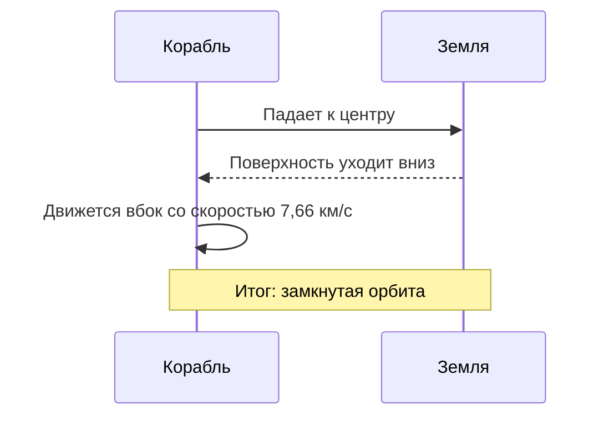

<!-- Test article for multilingual translation. Source language: English. Table-of-contents anchors follow the headings of each language. -->

# Тихое притяжение: как гравитация формирует наш мир

> **Коротко:** Гравитация — самое слабое из фундаментальных взаимодействий, и всё же именно она определяет форму планет, траектории спутников и ритм приливов. Статья прослеживает эту идею от падающего камня до часов, которые гравитация заставляет идти медленнее, объясняет закон обратных квадратов на нескольких простых числах и показывает, почему космонавты на космической станции на самом деле вовсе не ускользнули от притяжения Земли.

*Редакция · Опубликовано 2026-10-28 · Время чтения: около 12 минут*

---

## Содержание

- [1. Почему предметы падают](#1-почему-предметы-падают)
- [2. Краткая история давней идеи](#2-краткая-история-давней-идеи)
- [3. Закон обратных квадратов](#3-закон-обратных-квадратов)
- [4. Как взвесили Землю](#4-как-взвесили-землю)
- [5. Сила тяжести не везде одинакова](#5-сила-тяжести-не-везде-одинакова)
- [6. Падение вокруг планеты](#6-падение-вокруг-планеты)
- [7. Когда пространство искривляется](#7-когда-пространство-искривляется)
- [8. Как измеряют силу тяжести сегодня](#8-как-измеряют-силу-тяжести-сегодня)
- [9. Попробуйте сами](#9-попробуйте-сами)
- [Литература](#литература)

---

## 1. Почему предметы падают

Уроните ключ.

Он падает. Ну конечно, падает — и всё же вопрос о том, *почему* он падает, больше двух тысяч лет занимал лучшие умы человечества. Ответ, который мы принимаем сегодня, обманчиво прост: всякое тело, обладающее массой, притягивает всякое другое тело, обладающее массой, и чем больше эти массы, тем сильнее притяжение.

Два яблока на кухонном столе притягиваются друг к другу так слабо, что никакой обычный прибор этого никогда не уловит. Но Земля — не яблоко. При массе около 5,972 × 10²⁴ кг наша планета притягивает всё, что находится у её поверхности, настолько сильно, что падающий предмет разгоняется с ускорением примерно 9,81 м/с²: его скорость падения с каждой секундой растёт почти на десять метров в секунду — если сопротивлением воздуха можно пренебречь.

Прежде чем идти дальше, стоит чётко разграничить четыре понятия:

- **Масса** — количество материи в теле, измеряется в килограммах; она остаётся неизменной, куда бы вы это тело ни перенесли.
- **Вес** — сила, с которой тяготение действует на эту массу, измеряется в ньютонах; от места к месту он меняется.
- **Свободное падение** — движение под действием одной лишь силы тяжести, когда на тело не действует никакая другая сила.
- **Гравитационное поле** — область вокруг массы, в которой другая масса испытывает её притяжение.

Представьте женщину-космонавта: дома она весит 785 Н, а на Луне — всего около 130 Н, хотя не потеряла ни грамма. Её масса по-прежнему 80 кг; изменилось только притяжение.

## 2. Краткая история давней идеи

Кто первым задал правильный вопрос? Скорее всего, человек, чьего имени мы не знаем. Но горстка людей превратила этот вопрос в науку, и их имена есть почти в каждом учебнике:

1. **Галилео Галилей** (1564–1642) показал, что в отсутствие воздуха тяжёлые и лёгкие тела падают с одинаковым ускорением.
2. **Исаак Ньютон** (1643–1727) предложил единый закон, объяснивший и падение яблок, и обращение спутников вокруг планет.
3. **Генри Кавендиш** (1731–1810) измерил в лаборатории притяжение между свинцовыми шарами.
4. **Лоранд Этвёш** (1848–1919) с поразительной точностью проверил, одинаково ли падают тела из любых веществ.
5. **Альберт Эйнштейн** (1879–1955) переосмыслил гравитацию как искривление пространства и времени.

Сам Ньютон был осторожен в своих утверждениях. Он с большой математической точностью описал, *как* ведёт себя тяготение, но отказался придумывать механизм, которого не мог наблюдать. Во втором издании *«Начал»* он выразил эту позицию знаменитой латинской фразой *«Hypotheses non fingo»* — «Гипотез не измышляю»; переводчику следует оставить её на латыни, в точности как написал Ньютон.

Стоит задуматься, как странно, должно быть, звучало его предположение. Ньютон утверждал, что сила, из-за которой камешек срывается с утёса где-нибудь в Линкольншире, — та же самая сила, что заставляет Луну обращаться вокруг Земли с периодом в 27 суток, и что одна изящная формула, умещающаяся в строку, предсказывает оба движения с точностью лучших астрономических таблиц его времени.

Убедились не все. Некоторые критики называли эту идею «действием на расстоянии» и находили в ней что-то сродни магии. Их тревога была не так уж беспочвенна: более глубокого объяснения пришлось ждать больше двух столетий.

## 3. Закон обратных квадратов

Закон всемирного тяготения Ньютона умещается в одну строку:

```text
F = G · (m₁ · m₂) / r²
```

Здесь `F` — сила притяжения между двумя телами, `m₁` и `m₂` — их массы, `r` — расстояние между их центрами, а `G` — гравитационная постоянная. В строгой математической записи тот же закон выглядит так:

$$
F = G \frac{m_1 m_2}{r^2}, \qquad g = \frac{G M_\oplus}{R_\oplus^2} \approx 9.81\ \mathrm{m\,s^{-2}}
$$

Главное здесь — квадрат в знаменателе. Если увеличить расстояние вдвое, сила уменьшится не в два раза, а в четыре. Если втрое — останется лишь девятая часть.

| Расстояние от центра Земли | Пример                            | Относительное притяжение | Прибл. `g` (м/с²) |
|:-----------------------------|:----------------------------|--------------:|-------------------:|
| 1 × `R⊕`                     | Уровень моря                      |        100 % |               9,81 |
| 1,06 × `R⊕`                  | Международная космическая станция |         89 % |               8,73 |
| 2 × `R⊕`                     | Средняя околоземная орбита        |         25 % |               2,45 |
| 4 × `R⊕`                     | Чуть ниже орбит GPS               |       6,25 % |               0,61 |
| 60,3 × `R⊕`                  | Расстояние до Луны                |     0,0275 % |             0,0027 |

На схеме ниже та же мысль показана так, что её можно набросать на салфетке. Силовые линии распределяются по всё большей площади, поэтому на каждый квадратный метр их приходится всё меньше:

```text
                 r            2r                3r
   ●  ───────────┼─────────────┼─────────────────┼
 масса           │  1 квадрат  │   4 квадрата    │   9 квадратов
                 │  вся сила   │   1/4 силы      │   1/9 силы
```

Эту зависимость можно свести и к простой схеме:



## 4. Как взвесили Землю

Знать вид закона — одно. Знать значение `G` — совсем другое, а без него никто не смог бы сказать, какова на самом деле масса Земли.

В 1797–1798 годах Генри Кавендиш установил во флигеле своего лондонского дома прибор, называемый крутильными весами. Деревянное коромысло с двумя маленькими свинцовыми шариками висело на тонкой проволоке; к шарикам подводили два гораздо более крупных свинцовых шара, и ничтожное гравитационное притяжение между ними закручивало проволоку на угол, который Кавендиш измерял, глядя в зрительную трубу снаружи комнаты, чтобы тепло его собственного тела не тревожило воздух. По этому едва заметному повороту он вычислил плотность Земли, а по плотности — её массу; позднее физики извлекли из его данных первое достаточно надёжное значение гравитационной постоянной.

Современное рекомендованное значение:

```text
G = 6.674 30(15) × 10⁻¹¹ m³ kg⁻¹ s⁻²
```

Поразительно, но `G` по-прежнему известна хуже всех остальных фундаментальных постоянных. Её относительная неопределённость составляет около 22 миллионных долей — это гораздо больше, чем у скорости света или заряда электрона. Эксперименты стоимостью свыше 250 000 долларов (около 230 000 евро) до сих пор расходятся друг с другом уже в четвёртой значащей цифре.

Установка Кавендиша вдохновила целую череду последователей. Одна из них — вымышленная героиня нашей истории доктор Ильзе Форверк — одиннадцать зим продержала крутильные весы в подвале в Гёттингене. В (вымышленном) письме младшему коллеге она писала: *„Die Waage lügt nie; wir sind nur zu ungeduldig, um ihr zuzuhören.“* — «Весы никогда не лгут; просто нам не хватает терпения их выслушать». Немецкую фразу следует оставить на немецком.


> [!NOTE]
> Крутильные весы чрезвычайно чувствительны. Прохожий за стенами здания, проезжающий грузовик или изменение температуры в комнате всего на 0,1 °C способны полностью заглушить сигнал.

## 5. Сила тяжести не везде одинакова

Если вы всегда считали, что `9.81` — закон природы, приготовьтесь к небольшому разочарованию. Это всего лишь округлённое эталонное значение.

Наша планета — не идеальный шар, и она не стоит на месте. Из-за нескольких эффектов местное значение `g` немного меняется от точки к точке:

- Широта и вращение
  - На экваторе вращение Земли частично компенсирует силу тяжести.
    - Измеренное значение: около 9,780 м/с².
    - На полюсах: около 9,832 м/с², примерно на 0,5 % больше.
  - Экваториальный радиус планеты примерно на 21 км больше полярного.
- Высота
  - На вершине высокой горы вы находитесь дальше от центра Земли.
    - Сила тяжести убывает примерно на 0,3 % на каждые 10 км высоты.
- Местная геология
  - Плотные рудные тела увеличивают `g`; соляные купола и осадочные бассейны его уменьшают.

Все эти эффекты невелики, и ни один из них нельзя ощутить: человек, стоящий на полюсе или на экваторе, этой разницы не заметит, а обычные напольные весы её едва покажут, зато любой хорошо откалиброванный гравиметр её непременно зарегистрирует.

Колебания эти малы, но не лишены последствий. Геологи наносят их на карты, чтобы искать нефть, воду и полезные ископаемые; спутниковые миссии — чтобы следить, как сокращаются ледниковые щиты и истощаются запасы подземных вод.



*Рисунок 1. Земля из космоса. Планета кажется идеально круглой, но её экваториальный диаметр примерно на 43 км больше полярного.*

## 6. Падение вокруг планеты

Почему космонавты парят в невесомости? Многие думают, что на орбите нет гравитации. Её там предостаточно. На высоте Международной космической станции, примерно в 400 км над поверхностью, сила тяжести составляет почти 89 % от той, что действует на земле.

Космонавты парят потому, что они сами, их корабль и каждая незакреплённая ручка на борту падают вместе. Они движутся вбок так быстро — около 7,66 км/с, — что, пока они падают, искривлённая поверхность Земли уходит из-под них с той же скоростью, с какой они падают. Они падают *вокруг* планеты, но никогда — на неё.

Вымышленный космонавт из нашей тестовой истории Оксана Гриценко в первый же день на борту метко сказала по радио: «Тут ніщо не падає — усе просто летить разом зі мною.» По-русски: «Здесь ничего не падает — всё просто летит вместе со мной». Её слова на украинском следует оставить в точности такими, как она их произнесла.



<details>
<summary>Какая скорость нужна, чтобы покинуть Землю навсегда?</summary>

Чтобы улететь окончательно, без всякого дополнительного толчка, телу у поверхности понадобится около 11,2 км/с. Эта величина, называемая *второй космической скоростью*, не зависит от массы самого тела: песчинке и океанскому сухогрузу нужна одна и та же скорость.

</details>

## 7. Когда пространство искривляется

Больше двухсот лет закон Ньютона работал почти безупречно. Почти. Ближайшая к Солнцу точка орбиты Меркурия смещалась на крошечную добавочную величину — 43 угловые секунды за столетие, — и никакое расположение известных планет не могло этого объяснить.

В 1915 году Альберт Эйнштейн опубликовал общую теорию относительности, а вместе с ней — совершенно новую картину мира: масса и энергия искривляют пространство и время, а свободно движущиеся тела просто следуют по самым прямым из возможных путей в этой искривлённой геометрии. То, что Ньютон называл силой, Эйнштейн описал как форму самой сцены. Новая теория объяснила смещение Меркурия без всякой подгонки, предсказала, что свет звёзд отклоняется, проходя вблизи Солнца, и — что страннее всего — подразумевала, что часы вблизи большой массы идут медленнее, чем часы вдали от неё.

Неужели это всего лишь теория? Отнюдь. На ней держится каждый приёмник спутниковой навигации. Часы на спутниках GPS уходят вперёд примерно на 45 микросекунд в сутки, потому что находятся выше в гравитационном поле Земли, и отстают примерно на 7, потому что быстро движутся; без поправки итоговый уход на 38 мкс в сутки всего за один день сместил бы определяемое местоположение примерно на 10 км.

Вышедшая на пенсию учительница физики из Франции, вымышленная мадам Элен Гарнье, любила начинать уроки собственным афоризмом: « La pomme ne tombe pas : elle suit simplement le chemin le plus droit. » — «Яблоко не падает: оно просто идёт по самому прямому пути». Французскую фразу следует оставить на французском.

> [!WARNING]
> Не пытайтесь «проверять» свободное падение на ценных вещах, с высоты или рядом с другими людьми. Телефон, упавший с высоты 2 м, ударяется о пол со скоростью около 6,3 м/с — этого более чем достаточно, чтобы разбить экран.

## 8. Как измеряют силу тяжести сегодня

Современные приборы умеют то, что поразило бы Кавендиша. Абсолютный гравиметр сбрасывает зеркало в вакуумной камере и отслеживает его падение лазером; в сверхпроводящем гравиметре ниобиевая сфера парит в магнитном поле; атомные интерферометры используют в качестве пробных масс облака холодных атомов.

| Прибор                   | Принцип                     | Типичная точность       | Пример поля данных   |
|:-------------------------|:------------------------|------------------------:|:---------------------|
| Пружинный гравиметр      | Растянутая пружина          |    10 мкГал             | `g_rel`              |
| Абсолютный гравиметр     | Свободно падающее зеркало   |     2 мкГал             | `g_abs`              |
| Сверхпроводящий гравиметр | Левитирующая сфера         |   0,1 мкГал             | `g_sc`               |
| Пара спутников (на орбите) | Расстояние между аппаратами | около 1 мкм          | `range`              |

Один микрогал (мкГал) равен 10⁻⁸ м/с², то есть примерно одной миллиардной ускорения свободного падения, которое вы ощущаете прямо сейчас.

Контрольный список полевой бригады на один день съёмки может выглядеть так:

- [x] Зарядить аккумуляторы гравиметра за ночь
- [x] Записать показания на опорном пункте в 08:00 UTC
- [ ] Повторять опорное измерение после каждых 10 пунктов
- [ ] Сделать резервную копию данных перед уходом с участка

Данные съёмки обычно хранятся в простой структуре папок, примерно такой:

```text
survey-2026-10-28/
├── base/
│   └── base_station.csv
├── stations/
│   ├── st_001.csv
│   └── st_002.csv
└── README.txt
```

а каждый пункт описывается небольшим файлом метаданных:

```json
{
  "station_id": "st_001",
  "date": "2026-10-28",
  "latitude_deg": 50.4501,
  "elevation_m": 179.0,
  "g_mGal": 981045.37,
  "instrument": "CG-6",
  "operator": "field_team_b"
}
```

## 9. Попробуйте сами

Чтобы увидеть закон обратных квадратов в действии, лаборатория не нужна. Хватит нескольких строк на Python:

```python
G = 6.67430e-11        # гравитационная постоянная, m^3 kg^-1 s^-2
EARTH_MASS = 5.972e24  # kg
EARTH_RADIUS = 6.371e6 # m

def surface_gravity(mass_kg: float, radius_m: float) -> float:
    """Возвращает ускорение свободного падения на заданном расстоянии от центра."""
    return G * mass_kg / radius_m**2

for factor in (1, 2, 3, 4):
    g = surface_gravity(EARTH_MASS, EARTH_RADIUS * factor)
    print(f"{factor} x R: g = {g:.2f} m/s^2")
```

Сохраните код в файл `gravity.py` и запустите его из терминала:

```bash
python3 gravity.py
# ожидаемая первая строка:
# 1 x R: g = 9.82 m/s^2
```

В большинстве систем запущенный скрипт можно остановить сочетанием <kbd>Ctrl</kbd>+<kbd>C</kbd>. Если не хочется набирать код вручную, скопируйте его сочетанием <kbd>⌘</kbd>+<kbd>C</kbd> и вставьте в онлайн-блокнот.

Обратите внимание: скрипт выводит `9.82`, а не `9.81`. Это не ошибка. Формула не учитывает вращение Земли, которое на экваторе отнимает до 0,03 м/с², и считает планету идеальным шаром.

Несколько честных оговорок о домашних опытах:

3. Сопротивление воздуха значит гораздо больше, чем принято думать: лист бумаги и монета не упадут одновременно, хотя, если скомкать бумагу в шарик, разрыв между ними заметно сократится.
4. Время реакции — главный враг ручного хронометража падения: обычно оно составляет около 0,2 с, что сравнимо со временем всего падения предмета со стола.
5. У линеек и датчиков телефона есть собственные погрешности, поэтому повторяйте каждое измерение не меньше пяти раз.

Для любознательных: время, за которое тело без начальной скорости падает с высоты `h`, равно `t = √(2h / g)`; с высоты 1,5 м это около 0,55 с.\
Недолго, правда?

Небольшое типографское напоминание для тех, кто будет редактировать этот файл: символы \* и \_ записаны здесь с обратной косой чертой, чтобы они всегда отображались буквально, как в 2 \* 3 и file\_name, и никогда не могли превратить текст в *курсив* или **полужирный**. В ранних черновиках статьи утверждалось, что ~~ускорение свободного падения везде равно ровно 9,8 м/с²~~; в таблицах выше теперь приведены ***более точные значения***.

---

## Литература

1. Newton, I. *The Principia: Mathematical Principles of Natural Philosophy.* Trans. I. B. Cohen and A. Whitman. University of California Press, 1999. ISBN 978-0-000-00000-2.
2. Cavendish, H. "Experiments to Determine the Density of the Earth." *Philosophical Transactions of the Royal Society of London* 88 (1798): 469–526. doi:[10.5555/rstl.1798.0022](https://doi.org/10.5555/rstl.1798.0022)
3. Tiesinga, E., et al. "CODATA recommended values of the fundamental physical constants: 2018." *Reviews of Modern Physics* 93, 025010 (2021). doi:[10.5555/RevModPhys.93.025010](https://doi.org/10.5555/RevModPhys.93.025010)
4. NASA Science, обзорная страница «Earth»: https://example.org/nasa-science/earth/
5. Материалы о космической науке, в том числе об орбитах, можно найти на сайте [Европейского космического агентства][esa].

Исправления и вопросы присылайте на [editor@example.org](mailto:editor@example.org). Используемое во всей статье значение 9,81 м/с² — общепринятое округление стандартного значения 9,806 65 м/с²<sup>3</sup>.

[esa]: https://www.esa.int/Science_Exploration "Европейское космическое агентство — наука и исследования"

---

<!-- metadata: keep this footer unchanged in every language -->
**Document version:** `2.1.0` · **Last revised:** 2026-10-28 · **Format:** GitHub Flavored Markdown · **Licence:** CC BY 4.0 · **ID:** `bl-test-gravity-en`
