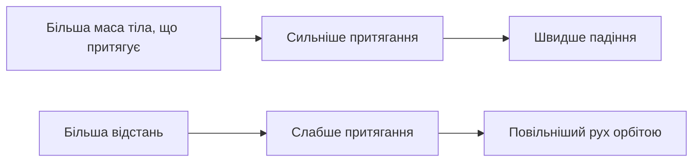
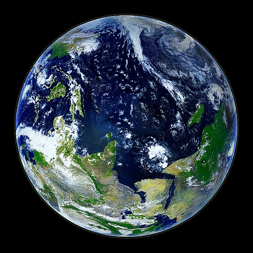
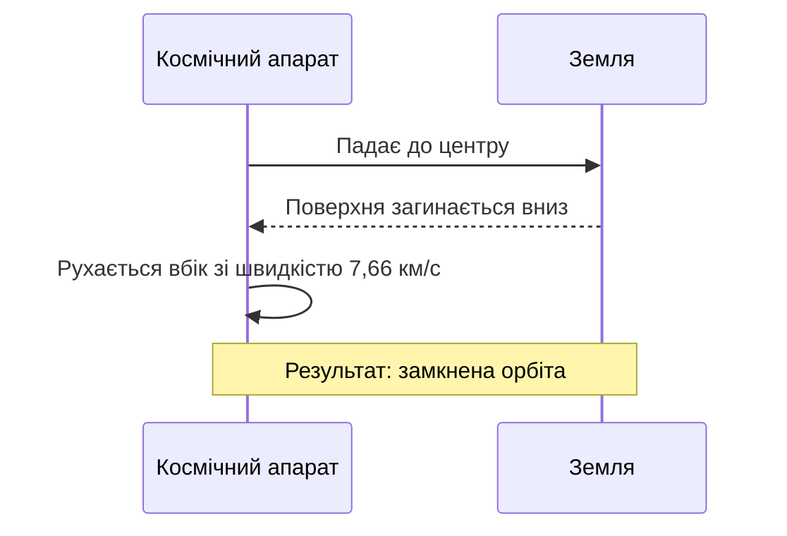

<!-- Test article for multilingual translation. Source language: English. Table-of-contents anchors follow the headings of each language. -->

# Тихе тяжіння: як гравітація формує наш світ

> **Коротко:** Гравітація — найслабша з фундаментальних взаємодій, проте саме вона визначає форму планет, траєкторії супутників і ритм припливів. Ця стаття простежує ідею від каменя, що падає, до годинника, який сповільнює хід, пояснює закон обернених квадратів на кількох простих числах і показує, чому астронавти на космічній станції насправді зовсім не вийшли з-під впливу Землі.

*Текст: редакція · Опубліковано 2026-10-28 · Час читання: близько 12 хвилин*

---

## Зміст

- [1. Чому предмети падають](#1-чому-предмети-падають)
- [2. Коротка історія довгої ідеї](#2-коротка-історія-довгої-ідеї)
- [3. Закон обернених квадратів](#3-закон-обернених-квадратів)
- [4. Як зважили Землю](#4-як-зважили-землю)
- [5. Сила тяжіння не всюди однакова](#5-сила-тяжіння-не-всюди-однакова)
- [6. Падіння навколо планети](#6-падіння-навколо-планети)
- [7. Коли простір викривлюється](#7-коли-простір-викривлюється)
- [8. Як вимірюють силу тяжіння сьогодні](#8-як-вимірюють-силу-тяжіння-сьогодні)
- [9. Спробуйте самі](#9-спробуйте-самі)
- [Джерела](#джерела)

---

## 1. Чому предмети падають

Відпустіть ключ.

Він падає. Ну звісно, падає — і все ж питання, *чому* він падає, понад дві тисячі років не давало спокою найвидатнішим мислителям в історії. Сучасна відповідь оманливо проста: кожне тіло, що має масу, притягує кожне інше тіло, що має масу, і що більші ці маси, то сильніше притягання.

Для двох яблук на кухонному столі це притягання таке мізерне, що жоден звичайний прилад ніколи його не зафіксує. Але Земля — не яблуко. Маючи масу близько 5,972 × 10²⁴ кг, наша планета притягує все поблизу своєї поверхні так сильно, що відпущене тіло падає з прискоренням приблизно 9,81 м/с² — тобто його швидкість униз щосекунди зростає майже на десять метрів за секунду, якщо знехтувати опором повітря.

Перш ніж рушати далі, варто розмежувати чотири поняття:

- **Маса** — кількість речовини в тілі, її вимірюють у кілограмах; вона та сама, хоч куди б ви це тіло перенесли.
- **Вага** — сила, з якою тяжіння діє на цю масу, її вимірюють у ньютонах; вона змінюється від місця до місця.
- **Вільне падіння** — рух лише під дією сили тяжіння, коли на тіло не діє жодна інша сила.
- **Гравітаційне поле** — область навколо маси, у якій інша маса відчуває її притягання.

Астронавтка, яка вдома важить 785 Н, на Місяці важить лише близько 130 Н, але не втратила жодного грама. Її маса, як і раніше, 80 кг; змінилося тільки притягання.

## 2. Коротка історія довгої ідеї

Хто першим поставив слушне запитання? Мабуть, ніхто з тих, кого ми могли б назвати. Але кілька людей перетворили це запитання на науку, і їхні імена є майже в кожному підручнику:

1. **Галілео Галілей** (1564–1642) показав, що без опору повітря важкі й легкі тіла падають однаково швидко.
2. **Ісаак Ньютон** (1643–1727) запропонував єдиний закон, який пояснив і падіння яблук, і рух супутників по орбітах.
3. **Генрі Кавендіш** (1731–1810) виміряв у лабораторії притягання між свинцевими кулями.
4. **Лоранд Етвеш** (1848–1919) з дивовижною точністю перевірив, чи всі речовини падають однаково.
5. **Альберт Ейнштейн** (1879–1955) переосмислив гравітацію як викривлення простору й часу.

Сам Ньютон був обережний у своїх твердженнях. Він з великою математичною точністю описав, *як* поводиться гравітація, але відмовлявся вигадувати механізм, якого не міг спостерігати. У другому виданні своїх *«Начал»* він підсумував цей підхід знаменитою латинською фразою *«Hypotheses non fingo»* — «Гіпотез не вигадую»; перекладачеві слід залишати її латиною, точно так, як її записав Ньютон.

Варто на мить зупинитися й уявити, як дивно мусило звучати його припущення. Ньютон стверджував, що сила, від якої камінець зривається зі скелі десь у Лінкольнширі, — це та сама сила, що утримує Місяць на шляху навколо Землі, який той долає раз на 27 діб, і що одна охайна формула, записана в один рядок, здатна передбачити обидва рухи з точністю найкращих астрономічних таблиць його часу.

Переконалися не всі. Дехто з критиків називав цю ідею «дією на відстані» й уважав її мало не магією. Їхня тривога не була зовсім безпідставною: глибшого пояснення довелося чекати понад два століття.

## 3. Закон обернених квадратів

Закон всесвітнього тяжіння Ньютона можна записати одним рядком:

```text
F = G · (m₁ · m₂) / r²
```

Тут `F` — сила притягання між двома тілами, `m₁` і `m₂` — їхні маси, `r` — відстань між їхніми центрами, а `G` — гравітаційна стала. У класичному математичному записі той самий закон має такий вигляд:

$$
F = G \frac{m_1 m_2}{r^2}, \qquad g = \frac{G M_\oplus}{R_\oplus^2} \approx 9.81\ \mathrm{m\,s^{-2}}
$$

Головне тут — квадрат у знаменнику. Збільште відстань удвічі — і сила зменшиться не вдвічі, а вчетверо. Утричі — і від неї залишиться лише дев’ята частина.

| Відстань від центру Землі    | Приклад місця               | Відносна сила тяжіння | Прибл. `g` (м/с²) |
|:-----------------------------|:----------------------------|--------------:|-------------------:|
| 1 × `R⊕`                     | Рівень моря                 |        100 % |               9,81 |
| 1,06 × `R⊕`                  | Міжнародна космічна станція |         89 % |               8,73 |
| 2 × `R⊕`                     | Середня навколоземна орбіта |         25 % |               2,45 |
| 4 × `R⊕`                     | Трохи нижче орбіт GPS       |       6,25 % |               0,61 |
| 60,3 × `R⊕`                  | Відстань до Місяця          |     0,0275 % |             0,0027 |

Схема нижче показує ту саму ідею так, як її можна було б накреслити на серветці. Силові лінії розходяться по дедалі більшій площі, тож на кожен квадратний метр їх припадає менше:

```text
                 r            2r                3r
   ●  ───────────┼─────────────┼─────────────────┼
 маса            │  1 квадрат  │   4 квадрати    │   9 квадратів
                 │  повна сила │   1/4 сили      │   1/9 сили
```

Цей зв’язок можна підсумувати й простою схемою:



## 4. Як зважили Землю

Знати вигляд закону — одне. Знати значення `G` — зовсім інше, а без нього ніхто не міг би сказати, яка насправді маса Землі.

У 1797 і 1798 роках Генрі Кавендіш установив у флігелі свого лондонського будинку прилад, який називають крутильними вагами. Дерев’яне коромисло з двома невеликими свинцевими кульками висіло на тонкому дроті; до малих кульок наближали дві значно більші свинцеві кулі, і крихітне гравітаційне притягання між ними закручувало дріт на кут, який Кавендіш зчитував у телескоп ззовні приміщення, щоб тепло його власного тіла не збурювало повітря. З цього мізерного закручування він обчислив густину Землі, а з густини — її масу; згодом фізики вивели з його даних перше гідне довіри значення гравітаційної сталої.

Сучасне рекомендоване значення:

```text
G = 6.674 30(15) × 10⁻¹¹ m³ kg⁻¹ s⁻²
```

Хоч як дивно, `G` досі залишається найменш точно відомою з фундаментальних сталих. Її відносна невизначеність становить близько 22 мільйонних часток — набагато більше, ніж у швидкості світла чи заряду електрона. Результати експериментів вартістю понад 250 000 доларів (приблизно 230 000 євро) досі розходяться між собою вже в четвертій значущій цифрі.

Прилад Кавендіша надихнув цілу низку наступників. Одна з них — вигадана героїня нашої історії доктор Ільзе Форверк — одинадцять зим тримала крутильні ваги в підвалі в Геттінгені. Ось що вона написала у (вигаданому) листі молодшому колезі: *„Die Waage lügt nie; wir sind nur zu ungeduldig, um ihr zuzuhören.“* — «Ваги ніколи не брешуть; просто нам бракує терпіння їх вислухати». Німецьке речення слід залишити німецькою.


> [!NOTE]
> Крутильні ваги надзвичайно чутливі. Перехожий біля будівлі, вантажівка, що проїжджає повз, або зміна температури в приміщенні всього на 0,1 °C можуть повністю заглушити сигнал.

## 5. Сила тяжіння не всюди однакова

Якщо ви завжди вважали, що `9.81` — це закон природи, приготуйтеся до невеликого розчарування. Це округлене стандартне значення.

Наша планета — не ідеальна куля, і вона не перебуває у спокої. Кілька чинників разом роблять місцеве значення `g` трохи різним у різних місцях:

- Широта й обертання
  - На екваторі обертання Землі частково компенсує силу тяжіння.
    - Виміряне значення: близько 9,780 м/с².
    - На полюсах: близько 9,832 м/с², тобто приблизно на 0,5 % більше.
  - На екваторі планета випинається приблизно на 21 км.
- Висота
  - На вершині високої гори ви перебуваєте далі від центру.
    - Втрата становить близько 0,3 % на кожні 10 км висоти.
- Місцева геологія
  - Щільні рудні тіла збільшують `g`; соляні куполи та осадові басейни його зменшують.

Усі ці ефекти невеликі, і жодного з них не можна відчути: жодна людина, що стоїть на полюсі чи на екваторі, ніколи не помітить різниці, а звичайні ваги у ванній ледве її вловлять, хоча кожен добре відкалібрований гравіметр неодмінно її зафіксує.

Ці відхилення невеликі, але не позбавлені наслідків. Геологи складають їхні карти, щоб шукати нафту, воду й корисні копалини; супутникові місії картографують їх, щоб стежити, як скорочуються льодовикові щити й виснажуються запаси підземних вод.



*Рисунок 1. Земля з космосу. Планета здається ідеально круглою, але її екваторіальний діаметр перевищує полярний приблизно на 43 км.*

## 6. Падіння навколо планети

Чому астронавти ширяють? Багато хто вважає, що на орбіті немає гравітації. Її там удосталь. На висоті Міжнародної космічної станції, приблизно за 400 км над поверхнею, сила тяжіння все ще становить майже 89 % від тієї, що діє на землі.

Астронавти ширяють тому, що вони самі, їхній корабель і кожна незакріплена ручка на борту падають разом. Вони рухаються вбік так швидко — приблизно 7,66 км/с, — що, поки вони падають, викривлена поверхня Землі опускається під ними так само швидко. Вони падають *навколо* планети, а не на неї.

Вигадана космонавтка з нашої тестової історії, Оксана Гриценко, першого ж дня на борту влучно сказала про це по радіо: «Тут ніщо не падає — усе просто летить разом зі мною.» Англійською: «Nothing falls up here — everything simply flies along with me». Її слова українською слід залишити саме такими, як вона їх промовила.



<details>
<summary>Наскільки швидко треба рухатися, щоб назавжди покинути Землю?</summary>

Щоб остаточно вирватися, без жодного додаткового поштовху, тілу біля поверхні знадобиться швидкість близько 11,2 км/с. Ця величина, яку називають *другою космічною швидкістю*, не залежить від маси самого тіла: піщинці й вантажному судну потрібна однакова швидкість.

</details>

## 7. Коли простір викривлюється

Понад двісті років закон Ньютона працював майже бездоганно. Майже. Найближча до Сонця точка орбіти Меркурія повільно зміщувалася на крихітну додаткову величину — 43 кутові секунди за століття, — якої не пояснювало жодне розташування відомих планет.

1915 року Альберт Ейнштейн опублікував загальну теорію відносності, а з нею — зовсім нову картину світу: маса й енергія викривлюють простір і час, а тіла, що рухаються вільно, просто йдуть найпрямішими з можливих шляхів у цій викривленій геометрії. Те, що Ньютон називав силою, Ейнштейн описав як форму самої сцени. Нова теорія пояснила зміщення орбіти Меркурія без жодних підгонок, передбачила, що світло зір відхилятиметься, минаючи Сонце, і — що найдивніше — з неї випливало, що годинники поблизу великої маси йдуть повільніше, ніж віддалені від неї.

Чи це лише теорія? Аж ніяк. На ній ґрунтується кожен приймач супутникової навігації. Годинники на супутниках GPS щодоби забігають уперед приблизно на 45 мікросекунд, бо перебувають вище в гравітаційному полі Землі, і відстають приблизно на 7, бо швидко рухаються; сумарне випередження в 38 мкс на добу, якби його не виправляли, вже за одну добу зсунуло б визначене положення приблизно на 10 км.

Французька вчителька фізики на пенсії — вигадана пані Елен Гарньє — любила починати уроки власним афоризмом: « La pomme ne tombe pas : elle suit simplement le chemin le plus droit. » — «Яблуко не падає: воно просто рухається найпрямішим шляхом». Французький текст слід залишити французькою.

> [!WARNING]
> Не намагайтеся «перевіряти» вільне падіння на цінних речах, з висоти чи поруч з іншими людьми. Телефон, упущений з висоти 2 м, вдаряється об підлогу зі швидкістю близько 6,3 м/с, а цього більш ніж досить, щоб розбити екран.

## 8. Як вимірюють силу тяжіння сьогодні

Сучасні прилади вміють таке, що вразило б Кавендіша. Абсолютний гравіметр скидає дзеркало у вакуумній камері й відстежує його лазером; надпровідний гравіметр утримує ніобієву кулю завислою в магнітному полі; атомні інтерферометри використовують як пробні маси хмари холодних атомів.

| Прилад                   | Принцип                 | Типова точність         | Приклад поля даних   |
|:-------------------------|:------------------------|------------------------:|:---------------------|
| Пружинний гравіметр      | Розтягнута пружина      |    10 мкГал             | `g_rel`              |
| Абсолютний гравіметр     | Дзеркало у вільному падінні |  2 мкГал            | `g_abs`              |
| Надпровідний гравіметр   | Куля в магнітній левітації | 0,1 мкГал            | `g_sc`               |
| Пара супутників (на орбіті) | Відстань між апаратами | близько 1 мкм        | `range`              |

Один мікрогал (мкГал) дорівнює 10⁻⁸ м/с², тобто приблизно одній мільярдній того земного тяжіння, яке ви відчуваєте просто зараз.

Контрольний список польової групи на один день гравіметричної зйомки може мати такий вигляд:

- [x] Поставити акумулятори гравіметра заряджатися на ніч
- [x] Записати показання на опорному пункті о 08:00 UTC
- [ ] Повторювати опорне вимірювання після кожних 10 пунктів
- [ ] Зробити резервну копію даних, перш ніж залишити ділянку

Дані зйомки зазвичай зберігають у простій структурі тек, приблизно такій:

```text
survey-2026-10-28/
├── base/
│   └── base_station.csv
├── stations/
│   ├── st_001.csv
│   └── st_002.csv
└── README.txt
```

а кожен пункт описує невеликий файл метаданих:

```json
{
  "station_id": "st_001",
  "date": "2026-10-28",
  "latitude_deg": 50.4501,
  "elevation_m": 179.0,
  "g_mGal": 981045.37,
  "instrument": "CG-6",
  "operator": "field_team_b"
}
```

## 9. Спробуйте самі

Щоб побачити закон обернених квадратів у дії, лабораторія не потрібна. Досить кількох рядків на Python:

```python
G = 6.67430e-11        # гравітаційна стала, м^3 кг^-1 с^-2
EARTH_MASS = 5.972e24  # кг
EARTH_RADIUS = 6.371e6 # м

def surface_gravity(mass_kg: float, radius_m: float) -> float:
    """Повертає прискорення вільного падіння на заданій відстані від центру."""
    return G * mass_kg / radius_m**2

for factor in (1, 2, 3, 4):
    g = surface_gravity(EARTH_MASS, EARTH_RADIUS * factor)
    print(f"{factor} x R: g = {g:.2f} m/s^2")
```

Збережіть код у файлі `gravity.py` і запустіть його з термінала:

```bash
python3 gravity.py
# очікуваний перший рядок:
# 1 x R: g = 9.82 m/s^2
```

У більшості систем запущений скрипт можна зупинити клавішами <kbd>Ctrl</kbd>+<kbd>C</kbd>. Якщо не хочете набирати код вручну, скопіюйте його клавішами <kbd>⌘</kbd>+<kbd>C</kbd> і вставте в онлайн-блокнот.

Зверніть увагу: скрипт виводить `9.82`, а не `9.81`. Це не помилка. Формула не враховує обертання Землі, яке на екваторі «з’їдає» до 0,03 м/с², і вважає планету ідеальною кулею.

Кілька чесних застережень щодо домашніх експериментів:

3. Опір повітря важить набагато більше, ніж думає більшість людей: аркуш паперу й монета не впадуть одночасно, хоча, якщо зім’яти папір у кульку, різниця стане набагато меншою.
4. Головний ворог ручного вимірювання часу падіння — час реакції: зазвичай він становить близько 0,2 с, що можна порівняти з тривалістю цілого падіння з висоти столу.
5. Лінійки й датчики телефонів мають власні похибки, тож повторюйте кожне вимірювання щонайменше п’ять разів.

Для допитливих: час, за який тіло без початкової швидкості падає з висоти `h`, дорівнює `t = √(2h / g)`; з висоти 1,5 м це приблизно 0,55 с.\
Небагато, правда ж?

Невелике типографське нагадування для всіх, хто редагуватиме цей файл: символи \* і \_ тут записано зі зворотною скісною рискою, щоб вони завжди відображалися буквально, як у 2 \* 3 і file\_name, і ніколи не могли перетворити текст на *курсив* чи **напівжирний**. У давніших чернетках цієї статті стверджувалося, що ~~прискорення вільного падіння всюди дорівнює рівно 9,8 м/с²~~; у таблицях вище тепер наведено ***точніші значення***.

---

## Джерела

1. Newton, I. *The Principia: Mathematical Principles of Natural Philosophy.* Trans. I. B. Cohen and A. Whitman. University of California Press, 1999. ISBN 978-0-000-00000-2.
2. Cavendish, H. "Experiments to Determine the Density of the Earth." *Philosophical Transactions of the Royal Society of London* 88 (1798): 469–526. doi:[10.5555/rstl.1798.0022](https://doi.org/10.5555/rstl.1798.0022)
3. Tiesinga, E., et al. "CODATA recommended values of the fundamental physical constants: 2018." *Reviews of Modern Physics* 93, 025010 (2021). doi:[10.5555/RevModPhys.93.025010](https://doi.org/10.5555/RevModPhys.93.025010)
4. NASA Science, огляд «Earth»: https://example.org/nasa-science/earth/
5. Довідкові матеріали з космічної науки, зокрема й про орбіти, можна знайти на сайті [Європейського космічного агентства][esa].

Виправлення й запитання надсилайте на [editor@example.org](mailto:editor@example.org). Значення 9,81 м/с², яким ми користуємося в усій статті, — це загальноприйняте округлення стандартного значення 9,806 65 м/с²<sup>3</sup>.

[esa]: https://www.esa.int/Science_Exploration "Європейське космічне агентство — Наука та дослідження"

---

<!-- metadata: keep this footer unchanged in every language -->
**Document version:** `2.1.0` · **Last revised:** 2026-10-28 · **Format:** GitHub Flavored Markdown · **Licence:** CC BY 4.0 · **ID:** `bl-test-gravity-en`
